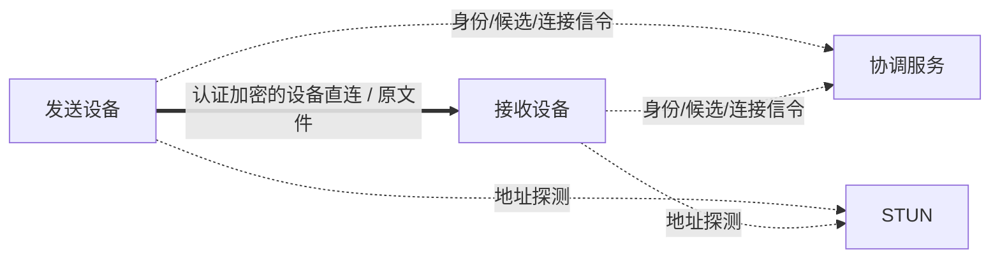
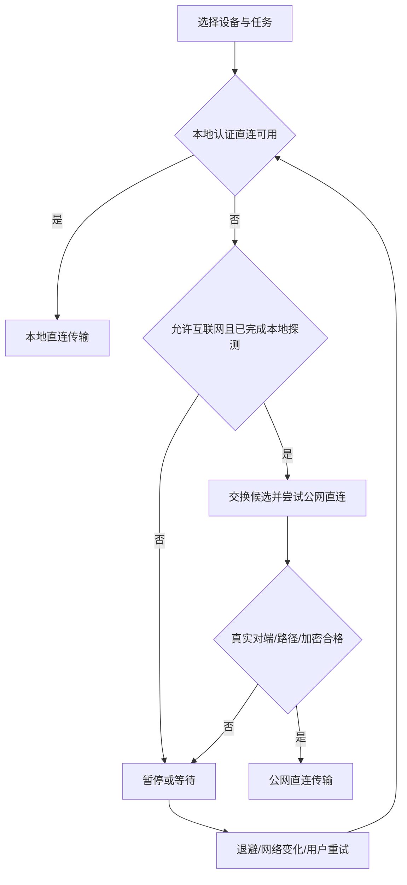

# 系统架构

## 数据流

图中虚线仅为控制流，粗线唯一文件流。不存在服务器文件通道。

## 模块和边界

| 模块 | 输入/输出 | 限制 |
|---|---|---|
| DeviceIdentity | 本机密钥、安全配对、对端指纹 | 私钥不出设备；不信任服务器替换公钥 |
| DiscoveryService | 本地服务广播、已知地址候选 | 发现不等于授权；不广播用户文件资料 |
| SignalingService | 有界结构化连接消息 | 无文件正文/清单/哈希/通用 blob |
| NatTraversalService | 映射发现、候选检查、打洞协调 | 不使用 TURN/relay |
| DirectConnectionManager | 已验证实际连接→直连句柄 | 未知路径/代理/relay/身份不符关闭 |
| FileTransferEngine | 直连句柄、SourceHandle、SaveTarget | 没有服务器上传客户端；有界缓冲 |
| FileStorageEngine | 本地授权读写、验证、提交 | 目录越界防护和权限失效处理 |
| TaskStore | SQLite 任务和检查点 | 完成标记必须晚于最终校验/保存 |
| PlatformLifecycle | 原生后台/通知/权限 | 不假设 UI 生命周期即传输生命周期 |
| UI | 命令和进度事件 | 不反复跨语言复制整个文件 |

## 接口约定（目标，未全部实现）

`SourceHandle`：只读访问、大小/版本检测、可能支持随机读取的能力声明。
`SaveTarget`：授权目录标识、可用空间（可能未知）、随机写/安全提交能力、授权失效错误。
`AuthenticatedDirectChannel`：与明确设备密钥绑定，来源为可信传输适配器；禁止 UI 或远端信令自行构造。
`TransferJob`：不随网络路径变化换身份；连接重建后以持久检查点重新协商。

当前 `ak-core` 的 Observation/Policy 仅表达决策，外部调用方能够填入观察值，不能替代真实网络证据。
正式适配器接入前必须缩小生产接口可见性、校验 TLS/Noise 对端身份，并确认底层没有隐式代理。
局域网分类不能只看私网 IP：VPN 可能使用私网，IPv6 LAN 也可能使用全局地址。需要本机接口、路由、实际探测综合判断。

## 服务故障

既有稳定直连可继续，控制服务器不充当逐块授权点。新公网连接可能因协调不可用而失败。
局域网模式离线完成发现/配对；已有授权与凭据不会因账号服务暂不可用被无故清空。
路径发生变化先停正文，再重新认证/验证；不依靠“曾经是直连”永久放行新路径。
