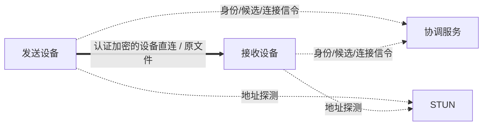
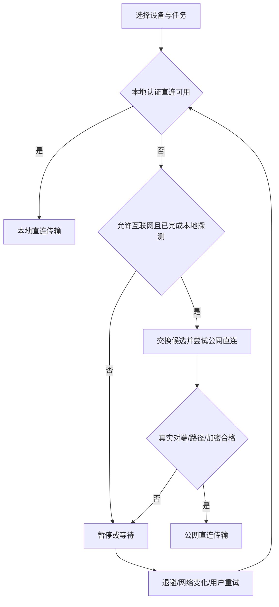

# 系统架构

## 数据流

图中虚线仅为控制流，粗线唯一文件流。不存在服务器文件通道。

## 模块和边界

| 模块 | 输入/输出 | 限制 | 现状（2026-11-03） |
|---|---|---|---|
| DeviceIdentity | 本机密钥、安全配对、对端指纹 | 私钥不出设备；不信任服务器替换公钥 | 已实现＋测试（`ak-identity`：Ed25519 密钥、BLAKE3 指纹、配对码、PeerBook、自签证书与钉扎验证；私钥暂为用户目录种子文件，未接系统安全存储） |
| DiscoveryService | 本地服务广播、已知地址候选 | 发现不等于授权；不广播用户文件资料 | 已实现＋测试（`ak-discovery`：手工地址、mDNS、信令候选与本地优先排序；mDNS 为尽力而为） |
| SignalingService | 有界结构化连接消息 | 无文件正文/清单/哈希/通用 blob | 已实现＋测试（`ak-signal`：TCP 信令服务器/客户端＋内置 STUN；封闭消息集与限频、对抗加固（TCP 帧模糊/STUN 洪泛/限频旁路实测存活）与控制字符注入防护（codec 拒绝 C0/DEL/C1）由测试锁定） |
| NatTraversalService | 映射发现、候选检查、打洞协调 | 不使用 TURN/relay | 部分（`ak-signal::stun` STUN 映射查询与 `ak-net` 同 socket UDP 打洞已实现并在环回＋本机网卡验证；双栈端点 `bind_dual_stack`、v4-mapped `classify` 展开、`holepunch::bind_dual_stack_udp` 打洞 socket 本机实测可用——含 socket2 `only_v6` Windows 缺陷规避与间歇 `WSAENETUNREACH` 如实记录；真实 NAT/跨网未测，端口映射未启用） |
| DirectConnectionManager | 已验证实际连接→直连句柄 | 未知路径/代理/relay/身份不符关闭 | 已实现＋测试（`ak-net`：DirectEndpoint/DirectChannel、指纹钉扎、路径分类启发式；并发接收 `ak-engine::serve_concurrently`——一次 bind、每连接独立任务/检查点，失败任务不拖垮他者） |
| FileTransferEngine | 直连句柄、SourceHandle、SaveTarget | 没有服务器上传客户端；有界缓冲 | 已实现＋测试（`ak-engine`：环回集成测试＋5 GiB 稀疏文件 release 测试；带内 Pause/Resume 与空闲超时已于第二轮实现（能力协商），多根/存储满预检/策略闸门第三至五轮补齐；单次 receive 一个任务、并发接收见 `serve_concurrently`） |
| FileStorageEngine | 本地授权读写、验证、提交 | 目录越界防护和权限失效处理 | 已实现＋测试（`ak-storage`：扫描、路径越界与符号链接防护、`.akpart` 原子提交、断点续传；长文件名 part 回退命名 `.akpart-<hash16>`——249 字节边界实测缺陷修复，续传兼容，孤儿清理识别两种 part 形态） |
| TaskStore | SQLite 任务和检查点 | 完成标记必须晚于最终校验/保存 | 已实现＋测试（`ak-store`：file 与 sqlite 双后端——行式文件检查点＋`SqliteCheckpointStore`（可选特性 `sqlite`，rusqlite bundled，默认依赖图零泄漏；事务原子性、双连接 WAL 并发、与文件后端语义等价）；`migrate_file_to_sqlite` 迁移工具：好记录迁移、损坏文件跳过计数） |
| PlatformLifecycle | 原生后台/通知/权限 | 不假设 UI 生命周期即传输生命周期 | 未开始（无平台适配层） |
| UI | 命令和进度事件 | 不反复跨语言复制整个文件 | 未开始（`ak-cli` 命令行原型已实现：keygen/fingerprint/send/receive/discover/signal-server/probe，非 UI） |

## 接口约定（2026-11-03：下列接口均已实现并有测试）

`SourceHandle`（`ak-core::handle`，实现见 `ak-storage::LocalSource`）：同步 trait。`manifest() -> &Manifest`；`read_chunk(file_index: u32, chunk_index: u64, buf: &mut [u8]) -> io::Result<usize>`（按清单分块随机读，长度以调用方缓冲为界）；`verify_stable() -> Result<(), ErrorCode>`（按大小/mtime 复查源未漂移，漂移返回 `SourceChanged`）。
`FileSink`（实现见 `ak-storage::LocalFileSink`）：`write_chunk(chunk_index: u64, data: &[u8])`（逐块摘要校验，不匹配即失败、不落盘）；`verified_prefix_chunks() -> u64`；`finish()`（整文件摘要＋fsync＋原子改名后才出现最终名）；`discard(self)`（消费式丢弃 part 文件）。
`SaveTarget`（实现见 `ak-storage::LocalSaveTarget`）：`root()`；`available_bytes() -> Option<u64>`（Windows 无稳定 API，返回 `None`，空间不足以真实写错误暴露）；`prepare_file(entry, conflict: ConflictPolicy) -> io::Result<Box<dyn FileSink>>`（创建前先做越界与符号链接检查）。`ConflictPolicy` 仅 `Fail`/`Rename`，不静默覆盖。
`DirectChannel`（即原 `AuthenticatedDirectChannel` 角色，`ak-net`）：`DirectEndpoint::bind(addr, identity)` / `bind_with_socket(socket, identity)`（复用打洞 socket 保住 NAT 映射）；`connect(peer, pinned: &Fingerprint) -> Result<DirectChannel, _>`（钉扎不匹配即断）；`accept(authorize: &(dyn Fn(&Fingerprint) -> bool + Send + Sync))`（自签证书验证后按指纹回调授权）。`DirectChannel` 无公开构造函数，仅由上述校验路径产生，暴露 `peer_fingerprint()`/`path()` 与双向流 `open_bi/accept_bi`（帧收发见 `DirectStream`/`DirectSendStream`/`DirectRecvStream`）；`ak-engine` 只接受该类型。
`TransferJob`：不随网络路径变化换身份；连接重建后以持久检查点重新协商。（已实现形态：`ak-engine` 以 `blake3(root_name||逐文件路径/大小/mtime/摘要||chunk_size)[..16]` 确定性生成 job id，同源同 id，续传沿用同一任务。）
`serve_concurrently`（`ak-engine`）：`serve_concurrently(spec: ReceiveSpec, expected_jobs: usize, progress: &(dyn Fn(u64, Progress) + Send + Sync)) -> Vec<Result<Report, EngineError>>`——一次 bind 并发服务多个发送端；第 i 个结果槽（及进度回调首参）＝第 i 个被接受连接（0 起），失败任务只落自身槽位，每任务独立检查点与 part 文件；完成条件为 `expected_jobs` 个连接全部结束，无停止通道，慢发送方以 `ReceiveSpec::idle_timeout` 约束（未满槽报 `IdleTimeout`）。
`DirectEndpoint::local_addr_display`（`ak-net`）：`local_addr_display(&self) -> io::Result<Vec<SocketAddr>>`——本机各接口地址配真实绑定端口的可通告候选列表（排除环回、v4-mapped 展开为纯 IPv4），探测/发现层直接用作连接候选；双栈端点的 `local_addr()` 为 `[::]:port`，对外通告以本列表为准。

当前 `ak-core` 的 Observation/Policy 仅表达决策，外部调用方能够填入观察值，不能替代真实网络证据。
正式适配器接入前必须缩小生产接口可见性、校验 TLS/Noise 对端身份，并确认底层没有隐式代理。
局域网分类不能只看私网 IP：VPN 可能使用私网，IPv6 LAN 也可能使用全局地址。需要本机接口、路由、实际探测综合判断。

## 服务故障

既有稳定直连可继续，控制服务器不充当逐块授权点。新公网连接可能因协调不可用而失败。
局域网模式离线完成发现/配对；已有授权与凭据不会因账号服务暂不可用被无故清空。
路径发生变化先停正文，再重新认证/验证；不依靠“曾经是直连”永久放行新路径。
