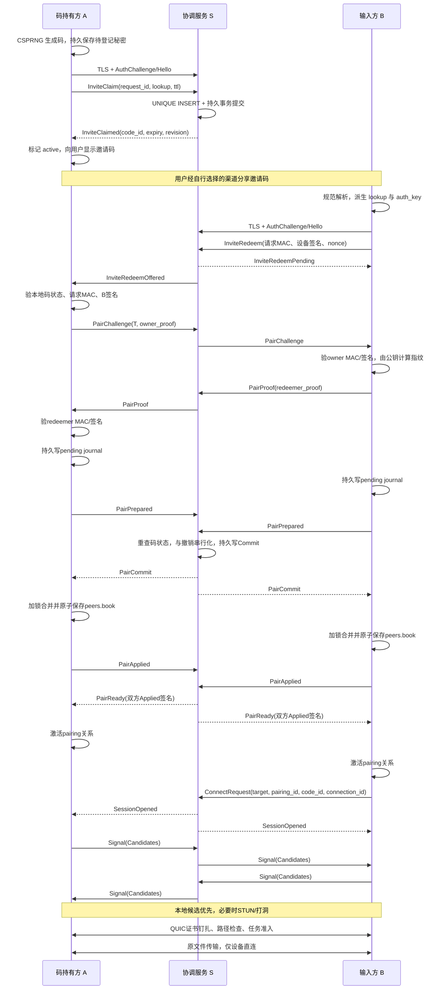

# 配对流程契约（claim / redeem / revoke 时序、错误码、防暴力）

> **冻结于第十八波（2026-11-04），修改需集成者核准并同步 ADR-004。**
> **第二十八波修订（2026-11-06）：端点交换扩展段与单次兑换语义，见第 4a、6a、12a 节；第 12 节错误表新增 `0x2109`。**
> 事实源：`docs/plans/pairing-code-plan-part2.md` A.2、A.3、A.5、A.6 节。本文为 A2（服务端事务）、A4（邀请码与信任簿事务）、A6（自动配对编排）的契约；数字与计划原文逐字一致。消息字段与预算见 `protocol-v2.md`，数据库表见 `storage-schema.md`。

## 1. 命名、码格式与生成方（冻结）

**新功能统一命名为“配对邀请码”，代码类型使用 `InviteCode`，字段使用 `invite_code`。**

现有 `pairing_code(fingerprint)` 生成的 `123-456` 保持兼容，界面与文档改称“指纹核对短码”。新邀请码不能进入旧的六位码解析分支，也不能成为 `receive.expect` 的另一种隐式准入值。

| 项目 | 决定 |
|---|---|
| 随机源 | 客户端操作系统 CSPRNG，Rust 使用 `OsRng` |
| 随机内容 | 20 字节，160 bit 熵 |
| 编码 | Crockford Base32，32 个有效字符 |
| 字符集 | `0123456789ABCDEFGHJKMNPQRSTVWXYZ` |
| 展示格式 | `AKI1-XXXX-XXXX-XXXX-XXXX-XXXX-XXXX-XXXX-XXXX` |
| 规范化 | ASCII 小写转大写；仅接受规定位置的 `-` 或无分组形式 |
| 拒绝 | Unicode 同形字符、控制字符、任意空白、错误长度、未定义字符 |
| 有效时间 | 默认长期有效；可选择短期 TTL |
| 生效节点 | 服务端持久 claim 成功后才显示为“有效” |

`AKI1` 是格式版本，不计入随机熵。不使用现有 `ak-signal::util::unique_bytes` 生成邀请码或认证 nonce：它是时钟与计数器派生工具，不是密码学随机源。

**推荐客户端生成、服务端登记。**

| 方案 | 优点 | 代价与决定 |
|---|---|---|
| 客户端生成 | 服务器无需知道明文邀请码；可以利用邀请码在两端验证公钥交换 | 必须实现持久 claim、碰撞重试、请求幂等；采用 |
| 服务端生成 | 唯一性分配与返回流程较简单 | 服务器接触全部配对凭证；数据库、日志或服务端被侵入时风险扩大；不采用 |

随机性用于防猜测，**唯一性由权威数据库事务保证**，不能把“碰撞概率很低”写成“绝不重复”。

## 2. lookup/auth 双派生（冻结）

建议使用域分离的派生值：

```text
lookup_digest = BLAKE3_DERIVE_KEY("AK invite lookup v1", secret20)
auth_key      = BLAKE3_DERIVE_KEY("AK invite authentication v1", secret20)
```

服务器只接收 `lookup_digest`。`auth_key` 留在两个端点，用于后续固定握手记录的 MAC。

**不能直接把 `lookup_digest` 当成配对凭证。** 知道 lookup 的攻击者可以提交受限的查找请求，但不能生成端点所需的认证证明。

## 3. TLS 是必要前置条件（冻结）

新控制连接使用 TLS，验证协调服务身份，并绑定固定的 `RegistryId`。首版可采用明确配置的服务端证书公钥 pin；不得自动接受未知 pin，也不得降级现有明文 TCP。

Hello v2 的签名绑定：

```text
"AKHELLO2"
|| registry_id
|| TLS exporter
|| Hello 规范字段（不含 signature）
```

服务端先发 `AuthChallenge`，challenge 只能在当前 TLS 连接上使用一次，最长有效 10 秒。保留设备名 C0/DEL/C1 拒绝、Hello 新鲜度、重放缓存和帧限频。

TLS 解决链路窃听与假协调端问题；**仅有 TLS 不足以防止被入侵的协调服务替换首次配对公钥**，因此还需要邀请码派生的双端证明。

## 4. 码本身即授权，owner 必须在线自动处理（冻结）

推荐首版语义：

- 创建并分享邀请码，就是允许持码者与本设备配对。
- owner 不需要再次手动点击同意。
- owner 必须在线，由本地运行时验证证明并落簿。
- 长期有效表示凭证不会自动过期，不表示设备离线时服务器可以代替它写信任簿。
- owner 离线时本次尝试进入等待并按期限失败，客户端可退避重试。

同一码允许 owner 与多个 redeemer 分别配对。B、C 都兑换 A 的码，只产生 A↔B 和 A↔C 信任；不产生 B↔C 信任，也不允许 A 替它们转发文件。

## 4a. wave-28 修订：单次兑换（v1 极简配对模型）

第 4 节的“一码多配对”仍是默认（`max_redeems=0`＝无限，兼容旧流）。wave-28 起 `InviteClaim` 可携带 `max_redeems`（帧层扩展段，见 `protocol-v2.md` §10a）：

- `max_redeems=1` 是 v1 极简模型：一码＝一次传输任务＝恰好两个对象；一次配对 Commit 后该码即失效。
- 计数口径为该码名下 **committed/applied/ready** 状态的配对事务数；pending、aborted、过期尝试不消耗额度（一次失败尝试不会杀掉码）。
- 额度在**两处**强制（wave-29 修订）：redeem begin 时预检只是快速拒绝；**“一码恰双方”的不变量由最终 Commit 的同一写事务保证**——判定性 `PairPrepared` 在写入 `committed` 之前，于同一事务内重读 `max_redeems` 并重计 committed/applied/ready。多个 pending 同时在途（pending 不占额度）后竞争 Commit 时，恰好额度内的竞争者成功；超限者在**同一事务**内转为 `aborted`（aborted 不消耗额度），双端收到明确的 `PairError 0x2109 REDEEM_EXHAUSTED`（wave-30 修订 R29-P2-01：Commit 竞争路径 **scope＝Pairing，object＝pairing_id**，使生产客户端分派与 orchestrator 等待方真正送达；begin 预检路径保持 scope＝Code＋真实 request_id）。不允许只在 begin 预占额度后永不释放，也不允许提交后补减计数。
- 达到上限后，新的（不同 `request_id` 的）redeem 尝试**立即**返回 `PairError 0x2109 REDEEM_EXHAUSTED`（scope＝Code，object＝code_id）——该路径不做“统一期限”延迟：redeemer 已持有码本身，不存在存在性泄露新增面。
- 幂等/回放语义不变：同 `(redeemer, request_id)` 重放仍返回原 `InviteRedeemPending`（第 11 节防枚举形状不变），**包括 Commit 竞争失败（`0x2109`）之后重试同一 `request_id` 的情形**——失败事务已按 aborted 收尾，不改变重放答案；claim 侧同 `request_id` 同内容（含扩展段内容）仍重放原 `InviteClaimed`。
- 服务器实现：`invite_codes` 表新增 `max_redeems INTEGER NOT NULL DEFAULT 0` 列（schema v2，迁移为增量 `ALTER TABLE`，见第 12a 节末）。

## 5. claim：并发登记与幂等（冻结）

claim 的线性化点是**唯一索引保护下的 INSERT 事务提交**：

1. 客户端生成码并安全保存“待登记”记录。
2. 发送 `InviteClaim`。
3. 服务端根据已认证连接确定 owner，执行事务插入。
4. 同一码同时 claim，最多一个不同登记请求成功；其余返回 `CODE_CONFLICT`。
5. 客户端遇到真正碰撞后重新生成，单次操作最多重试 8 次。
6. 网络超时不直接生成新码；先以原 `request_id` 重试，获取同一次提交的结果。

幂等规则：

- 同 owner、同 `request_id`、同请求内容：返回原结果。
- 同 owner、同 `request_id`、不同内容：拒绝 `REQUEST_CONFLICT`。
- 同 lookup、不同请求：不能覆盖原 owner。
- 哈希碰撞最多导致新码登记失败，不能导致两个有效记录同时出现。

## 6. redeem 完整时序（冻结）



初始 `request_mac` 覆盖发行方、lookup、B 公钥、请求 ID、B nonce 和 deadline。owner 必须先验证它，才返回自己的身份与完整证明。

### prepare / commit / applied 状态机（冻结）

服务端持久事务状态为 **Prepared / Commit / Applied**（`pairing_transactions` 表职责，见 `storage-schema.md`），由上述时序中的消息驱动：

1. `InviteRedeemOffered`：服务端向 owner 投递（含 `pairing_id`、`deadline_ms`）；owner 验证本地码状态、请求 MAC 与 B 签名。
2. `PairChallenge`：owner 发送 `PairChallenge(transcript, owner_proof)`，服务端转发给 redeemer；redeemer 验 owner MAC/签名，由公钥计算指纹。
3. `PairProof`：redeemer 发送 `PairProof(pairing_id, transcript_digest, redeemer_proof)`，服务端转发，owner 验 redeemer MAC/签名。
4. `PairPrepared`：两侧各自持久写 pending journal 后分别发送 `PairPrepared(pairing_id, transcript_digest, signature)`。
5. `PairCommit`：服务端重查码状态、与撤销串行化、持久写 Commit（`commit_revision`），向双方下发 `PairCommit`。重发规则：已 Commit 的事务在 `PairStatusReply` 后由服务端重发固定 `PairCommit`。
6. `PairApplied`：双方各自加锁合并并原子保存 `peers.book` 后发送 `PairApplied(pairing_id, transcript_digest, commit_revision, signature)`。
7. `PairReady`：服务端收到双方 Applied 后下发 `PairReady`（含双方 Applied 签名）；两侧激活 pairing 关系。已 Ready 的事务在状态回复后由服务端重发固定 `PairReady`。

`PairStatusReply.state` 为封闭枚举（`protocol-v2.md` 第 6 节）；本地 journal 记录 Prepared、CommitSeen、BookApplied、Ready 四个持久边界（见第 9 节与 `storage-schema.md`）。未提交配对事务到期后可以 Abort（`PairAbort`），已持久 Commit 的事务必须恢复到完成或明确人工处理，不能按普通 TTL 丢弃（见第 8 节）。

### transcript MAC 构造（冻结）

```text
owner_mac = MAC(auth_key, "AK owner proof v1" || transcript)
redeemer_mac = MAC(auth_key, "AK redeemer proof v1" || transcript)

signature = Ed25519.Sign(
    device_key,
    对应角色域 || transcript || mac
)
```

`PairTranscript`（256 字节）字段布局见 `protocol-v2.md` 第 5 节。使用库提供的成熟 MAC/派生实现和恒定时间验证接口，不手写密码学原语。整个认证协议仍需独立审阅与固定测试向量，不能仅凭采用成熟哈希算法就宣称协议已经被证明安全。

## 6a. wave-28 修订：连接设置（端点）交换

v1 极简模型要求“双方都要拿到对方的连接设置，各自做一次连通性测试”。端点交换搭第 6 节既有帧的**帧层扩展段**（`protocol-v2.md` §10a，`EndpointBlob` ≤512B 原样透传、上层建议 JSON：候选地址数组＋设备名＋方向声明），不新增往返：

```text
A->>S: InviteClaim(+owner_endpoint, +max_redeems?)     ; owner 设置存入码行
B->>S: InviteRedeem(+redeemer_endpoint)                ; redeemer 设置存入配对事务
S-->>A: InviteRedeemOffered(+redeemer_endpoint)         ; owner 一次拿到对端设置
   ...（transcript 证明流程不变，第 6 节）...
S-->>B: PairCommit(+owner_endpoint)                     ; redeemer 在权威 Commit 点拿到
S-->>A: PairCommit(+owner_endpoint)                     ; 同一固定帧，owner 仅重见己方数据
```

冻结约束：

- 扩展段不存在＝旧形状，字节不变；旧客户端与旧服务器行为完全不变。
- 两个 blob 都是**连接提示，不是凭证**：不受 redeem/配对签名覆盖；实际连接仍走第 10 节的候选交换与 QUIC 证书钉扎/路径闸门。上层不得把 blob 当作身份证明。
- 断开配对（`max_redeems=1` 下完成一次配对）即码失效（第 4a 节）。
- 存储：`invite_codes.owner_endpoint BLOB NULL`；`pairing_transactions` 在 redeem 开始时快照 `owner_endpoint`/`redeemer_endpoint` 两列（schema v2）。
- `InviteRedeemOffered` 内嵌的 `redeem` 固定结构保持 184 字节不变，redeemer endpoint 挂在帧层而非该结构内（第 6 节“固定结构”约束继续成立）。

## 7. 防中间人：换钥检测与换码检测（冻结）

双方各自验证：

1. 收到的公钥具有有效的设备签名。
2. MAC 证明对端知道邀请码秘密。
3. transcript 绑定了双方身份、角色、发行方、码、请求、配对事务、双 nonce 与期限。
4. 指纹由公钥本地计算。
5. 已有信任不能因服务端返回新公钥而被静默替换。
6. 实际 QUIC 连接还要通过既有 DER、自签名、指纹钉扎与路径闸门。

因此，仅掌握服务端数据库 lookup 的攻击者，或者不知道邀请码秘密的恶意协调服务，不能单独伪造端点证明并让双方落簿。

**换钥检测**：transcript 绑定 `owner_device_id`/`redeemer_device_id` 且 MAC/签名覆盖完整 transcript——被入侵的服务端替换任一侧公钥将导致签名验证失败；对已有信任，服务端返回新公钥不能静默替换本地簿记录（第 9 节落簿规则）。

**换码检测**：MAC 以 `auth_key`（仅由码秘密派生）键入、transcript 绑定 `code_id`/`lookup_digest`/`code_revision`——交换、替换或重放其他码的 transcript/证明将导致 MAC 验证失败。A4 验证门槛明确覆盖“角色反射、换公钥、换码、换 nonce、过期证明”。

邀请码是 bearer credential：码泄露后，持有者具有配对能力。不能继续承诺该码可区分“原本想邀请的人”和“窃取了码的人”。需要核验具体人的场景，仍可独立核对完整设备指纹。

## 8. TTL、过期与撤销（冻结）

| 对象 | 生命周期 |
|---|---|
| 邀请码 | `ttl_secs=0` 表示长期；有限 TTL 为 60 秒至 30 天 |
| 一次 redeem 尝试 | 最长 120 秒 |
| 未提交配对事务 | 到期后可以 Abort |
| 已持久 Commit 的事务 | 必须恢复到完成或明确人工处理，不能按普通 TTL 丢弃 |
| 候选协调 session | 保持现有默认 120 秒 |
| 已建立的数据直连 | 不依赖邀请码 TTL 或协调 session 存活 |

过期判断在每次 redeem 与 Commit 事务内执行，不能只依赖定时清扫。已经进入 expired/revoked 的状态不可因时钟回拨恢复 active。服务器检测到异常时钟回退或数据库恢复缺口时，应停止发行和新的配对提交，先完成状态核对。

从旧备份恢复后，不能立即继续发码并声称唯一性完整；必须恢复全部已确认登记及撤销记录，或保持发行关闭。

**撤销、过期后也不复用旧码**：

- 保留最小 tombstone，至少包含 lookup、终态及必要版本信息。
- 不允许通过删除记录重新激活旧码。
- 避免用户从旧聊天记录复制一个已经被分配给陌生设备的码。
- 160 bit 空间足够大，没有依赖复用节省号码的必要。

**撤销含义**（三者独立）：

- **撤销邀请码**：阻止后续兑换。
- **移除配对设备**：撤销本地设备信任，阻止该设备的新任务。
- **取消任务**：停止某一传输实例。

撤销与配对 Commit 在同一权威事务域内排序：

- Revoke 先提交：尚未 Commit 的配对失败。
- Commit 先提交：此次配对保留；后续撤码不自动删除双方 `peers.book`。
- owner 离线撤码：先在本地持久标记“停用”，停止响应兑换；界面显示“服务器撤销待同步”，不能提前声称全局撤销成功。

**唯一性范围**：一个权威邀请码命名空间；无法访问权威库时拒绝发出有效邀请码（详见 ADR-004 与 `storage-schema.md`）。

## 9. 两侧落簿规则（冻结）

`PeerBook::save` 的原子替换只保护一个本地文件，不代表两个设备同时写入，也不保护并发 read–modify–write。

需要新增统一的事务式更新入口，例如：

```rust
PeerBookStore::apply_pairing(
    &self,
    verified: &VerifiedPairing,
) -> Result<ApplyOutcome, PeerBookError>;
```

要求：

- 文件锁覆盖读取、合并、保存全过程。
- CLI 手工 add/import/remove、FFI `ak_peer_*`、自动配对统一走该入口。
- 坏簿不能被当成空簿覆盖。
- 已有本地名称与首次配对时间按明确规则保留。
- 本地 journal 记录 Prepared、CommitSeen、BookApplied、Ready。
- 新增记录在 `PairReady` 前不能通过邀请码路径放行任务；准入同时检查配对 journal，不能只看 `book.get(fp).is_some()`。
- 延迟 Commit 不能复活用户已经移除的信任；用本地信任版本或 tombstone 拒绝旧事务重放。
- 一侧写失败时显示“配对尚未完成”；已 Commit 的事务重连后继续恢复，不能超时假报成功或盲目删除另一侧已保存的数据。

## 10. 进入既有候选交换的方式（冻结）

保留 `ConnectRequest → SessionOpened → Signal` 的流程，但 v2 session 按已验证的：

```text
(pairing_id, code_id, connection_id)
```

建立关联，不再只按设备对复用。

双方收到 `SessionOpened` 后，必须**主动发送当前候选**。候选只能指向本设备实际监听、探测所用端点，打洞与 QUIC 尽量复用同一 UDP socket。

仍保持每设备最多 4 个在建协调 session；已完成建连后释放短期协调 session。这个上限限制同时协调的连接数，不需要限制已建立的数据直连总数。

协调 session 结束、邀请码到期或服务器退出，都不得主动中断已经稳定且仍获本地授权的数据直连。

## 11. 防暴力与防枚举参数（冻结）

建议默认预算：

| 层级 | 默认限制 |
|---|---|
| 既有帧限频 | 保持每连接 32 帧/秒、突发 64 |
| redeem（已实现） | **每连接 10 次/分钟＋每来源 30 次/分钟＋每设备身份 30 次/分钟＋全局熔断 600 次/分钟**（2026-11-11 CR-P1-03 修订，替换 2026-11-09 基线 `37a57c0` 的"每连接 10＋全局 60"双桶：旧全局 60 次/分钟会被单一来源用约 6 个自生成身份以 6×10 次/分钟打满，**其他所有来源**的合法兑换随之全部 `RATE_LIMITED`）。四层顺序判定，任一层超限即在 lookup 前返回 `RATE_LIMITED`；重连仍获得新的每连接桶，但每来源/每身份窗口跨重连保留。全局 600 次/分钟是兜底总工作量的熔断值，远高于正常跨来源总需求，正常流量不应触达 |
| redeem 每设备 / 每 IP / IPv6 前缀 | **已实现**（2026-11-11 CR-P1-03）：来源按 IPv4 /32、IPv6 /64 归一，每来源 30 次/分钟；每设备身份（Hello 认证的 Ed25519 公钥）30 次/分钟。两者均为服务端共享滑动窗口表（跨连接、跨重连计数），表项带 TTL 空闲回收与容量上限；所有兑换尝试无论成败一律计数，不设单独的"查无此码"惩罚窗（码有 160 bit 熵，在线枚举不可行，预算的职责是限制总工作量而非惩罚猜测）；每身份窗口之上永远叠加每来源窗口，批量生成身份无法放大单一来源的兑换预算 |
| 同时 pending redeem | 每发起设备 4、每 owner 32、全局 4096 |
| 邀请码创建（claim，已实现） | 每 owner **30 次/小时**（2026-11-09 wave-34 `8e5ba7e` 从 6 上调：6/时对正常使用过紧，诊断期一设备即可烧尽；按 owner 持久计数、含已撤销的行，重连与撤码不重置）。**claim 与 redeem 是两组独立预算** |
| active 邀请码 | 每 owner 32 |
| 名下配对关系 | 有界存储配额，建议首版 1024；达到上限明确拒绝 |
| TLS / 未认证连接 | 独立握手并发、IP 预算、首帧与写入 deadline：**每来源（IPv4 /32、IPv6 /64）并发连接上限 8、其中握手中（已 accept、TLS 未完成）上限 4**（2026-11-11 CR-P1-03；accept 时检查，任一超限直接断开该 socket、不 spawn 任务——只连不握手的连接无法再占住全局名额）；TLS 握手期限 10 秒（CR-P1-03 从 30 秒缩短）、首帧期限 15 秒、每帧读写期限 30 秒；以上预算均在连接结束时即释放并带 TTL 回收，无泄漏 |
| 客户端请求 map / 收件箱 | 有界，取消、完成、超时立即回收 |
| 服务端 outbox | 保持有界；写入超时断开慢消费者 |

设备密钥可以批量生成，设备限速不能独立承担防暴力；必须叠加 IP、前缀、owner 与全局资源预算。共享出口可能误伤正常用户，限速提示允许重试，但不能据此放开凭证强度或消息预算。

**错误响应取舍（不泄露存在性的结论）：**

- 格式错误在本地拒绝。
- 配额拒绝在 lookup 查询前执行，返回 `RATE_LIMITED` 或 `RESOURCE_LIMIT`。
- 不存在、错误、过期、撤销、owner 离线、MAC 无效，兑换方最终统一看到 `PAIR_UNAVAILABLE`。
- 初始 `InviteRedeemPending` 对存在与不存在的码使用相同字段形状。
- 失败采用统一期限策略，不即时返回“该码存在但对方离线”。
- 成功当然会暴露码可用；不声称完全消除所有时序侧信道。
- owner 查询自己的列表，可以看到真实 active/revoked/expired 状态。
- 错误尝试不得永久锁死或自动撤销别人的长期码，主要处罚发起设备和来源地址。

## 12. PairError 固定错误码（冻结）

建议固定业务错误码：

```text
0x2101 PAIR_UNAVAILABLE
0x2102 RATE_LIMITED
0x2103 RESOURCE_LIMIT
0x2104 REQUEST_CONFLICT
0x2105 CODE_CONFLICT
0x2106 REVISION_CONFLICT
0x2107 PROTOCOL_UNSUPPORTED
0x2108 STORAGE_UNAVAILABLE
0x2109 REDEEM_EXHAUSTED
```

`CODE_CONFLICT` 仅用于高熵随机码登记冲突，不提供公开“检查某码是否存在”的接口。

`ServerError` 保留有界旧类错误；邀请码业务错误走固定 `PairError`（tag `0x1C`，含 `retry_after_ms`），不回显用户输入。

## 12a. wave-28 修订：`0x2109 REDEEM_EXHAUSTED` 与存储变更

- `0x2109 REDEEM_EXHAUSTED`（第二十八波新增；wave-29 扩展到 Commit 竞争路径）：码行 `max_redeems ≥ 1` 且已达到 committed 配对数上限时的拒绝码，`retry_after_ms=0`，**两条路径的 scope 不同（与 §4a 及实现一致）**——(a) 对新 redeemer 的立即拒绝路径 scope＝**Code**，object＝code_id；(b) 同一码上竞争 Commit 的超限 pending 在判定性 `PairPrepared` 的事务内失败时 scope＝**Pairing**，object＝pairing_id（wave-30 R29-P2-01：使生产客户端分派与 orchestrator 等待方真正送达），双端收到明确错误。语义与第 4a 节同步。
- 存储变更（registry schema v1 → v2，迁移为增量 `ALTER TABLE`，保留全部 tombstone/唯一性记录；wave-29 起迁移 DDL 与版本推进在同一写事务内原子完成，半迁移库按列存在性识别并补齐，见 `storage-schema.md` §5）：
  - `invite_codes` ＋ `owner_endpoint BLOB NULL`、`max_redeems INTEGER NOT NULL DEFAULT 0`；
  - `pairing_transactions` ＋ `owner_endpoint BLOB NULL`、`redeemer_endpoint BLOB NULL`（redeem 开始时从码行/redeem 帧快照）。
- claim 幂等体的规范编码跨版本稳定（wave-29；wave-30 增补 36B/41B 等价条款，R29-P2-02）：默认扩展下与 v1 布局逐字节一致，升级前 journal 的旧 claim 记录升级后重放原响应；wave-28 服务器对默认扩展也无条件写入尾部，产生的 41 字节记录（`cap=0[4]+presence=0[1]` 全零尾）与 36B canonical 体视为**同一 canonical 请求**——重放比较在读取侧归一化，存量磁盘行不迁移、不改写，非默认扩展仍逐字节比较，真实 ttl/cap/endpoint 差异仍 `REQUEST_CONFLICT`（等价性与不可碰撞论证见 `storage-schema.md` §5）。
- claim 幂等在 journal 回收后仍成立（2026-11-09 修订，R36-P2-05）：服务器把"同 owner+create_request_id 的既有请求"识别放在新建配额与 lookup 碰撞检查**之前**；journal 行被回收（24 小时/4096 行上限）后，迟到重试按 `invite_codes` 行持久化的 canonical 请求体与原响应字节恢复原结果（schema v2→v3 增列，v3 前旧行由不可变列重建、claim 时刻 revision 恒为 1），不得返回 `CODE_CONFLICT` 或配额拒绝；真实 ttl/cap/endpoint/lookup 差异仍 `REQUEST_CONFLICT`（详见 `storage-schema.md` §2/§5）。
- `storage-schema.md` 的 DDL 附录待集成者随本次修订一并同步（本波协议/服务器代理的文档权限不含该文件）。

## 13. 安全边界补充（第十七波边界全部保留）

- Hello 缓存目前容量满后会逐出条目；新流程不能将其描述为完整重放证明。
- 新 challenge 使用一次即失效；缓存压力下拒绝过载，不能淘汰仍有效的安全记录后继续接受。
- 缓存覆盖合法未来时间戳对应的完整接受区间，补未来时间戳、容量压力和跨连接重放测试。
- 邀请码请求另有 nonce、deadline、request ID 和持久幂等控制。
- 新字符串延续 C0/DEL/C1 规则。
- 日志、`Debug`、FFI 错误、诊断报告不记录邀请码、lookup、MAC 或秘密文件内容。
- 新依赖重新检查 TLS 配置、代理使用、relay 默认值、权限和协议兼容。

## 14. 客户端约束（A3/A6 相关，随本契约冻结）

- CLI 配对命令必须复用常驻运行时，避免把 daemon 的控制连接挤掉（同一设备重新登录会替换旧控制连接）。
- 客户端请求分派采用单 reader，按 request/pairing/connection ID 分派；收件箱有界。
- owner 自动配对编排（A6）：收证、写 journal、落簿、Ready、撤销同步；验证门槛包括“服务器单独换钥失败；只一侧写成功不显示完成；延迟 Commit 不复活信任”。
