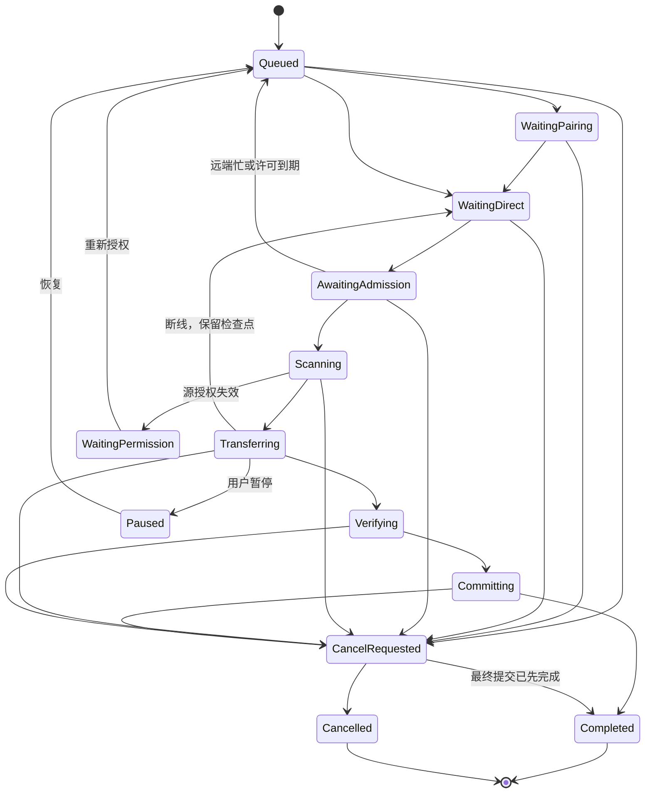

# 共享调度层契约（ak-session：两维并发、TaskState、permit 准入）

> **冻结于第十八波（2026-11-04），修改需集成者核准并同步 ADR-004。**
> 事实源：`docs/plans/pairing-code-plan-part2.md` B.1–B.6 节。本文为 B0（`crates/ak-session/src/scheduler/`）与 B6（`crates/ak-session/src/runtime/`）的契约；数字与计划原文逐字一致。C ABI 形状见 `ffi-v2.md`，持久 schema 见 `storage-schema.md`。

## 1. 模块与依赖方向（冻结）

**推荐新增 `ak-session`，其中包含 `scheduler`、`pairing`、`runtime` 模块。CLI 与 FFI 共用它。**

不把产品调度策略分别放在 CLI daemon 和 Flutter，也不把邀请码生命周期塞进文件协议引擎。暂不额外拆第二个 `ak-scheduler` crate：当前配对关系、连接生命周期与队列高度相关，在一个共享应用层中划分模块更容易保持一致。

依赖方向：

```text
ak-cli ─┐
        ├── ak-session ── ak-signal
ak-ffi ─┘       │        ak-identity
                │        ak-store
                └────── ak-engine ── ak-net / ak-wire / ak-storage
```

职责划分：

| 模块 | 职责 |
|---|---|
| `ak-session::pairing` | 邀请码与配对事务编排，消费已验证的身份材料 |
| `ak-session::scheduler` | 两维并发策略、队列、背压、公平性、任务准入 |
| `ak-session::runtime` | 单身份运行时、常驻监听、信令分派、重试、取消、关闭 |
| `ak-engine` | 一次任务的单流/多流文件协议执行 |
| `ak-store` | 本地队列、配对 journal、恢复映射 |
| `ak-storage` | 每任务 staging、路径安全、目标竞争与最终提交 |
| CLI / FFI / Dart / GUI | 提交命令、观察状态与展示结果 |

## 2. 两维并发语义（冻结）

定义分组键：

```text
CodeGroupKey = (registry_id, code_id)
```

一码对应一个 owner。owner 对这个码产生的所有关系统一执行同码策略，包括：

- A→B；
- B→A；
- A→C；
- C→A。

不能把同一码拆成“每个对端各串行一次”，否则 B、C 同时向 A 发送时仍会突破“同码串行”。

| `same_code_mode` | `cross_code_mode` | 实际行为 |
|---|---|---|
| `serial`，默认 | `parallel`，默认 | 每码最多一个活跃任务，不同码可同时传输 |
| `parallel` | `parallel` | 同码及不同码均可并行，受资源上限约束 |
| `serial` | `serial` | 只有一个活跃码组，该组一个任务 |
| `parallel` | `serial` | 只有一个活跃码组，该组内部可运行多个任务 |

这里“不同码的连接串行”限制的是**进入传输服务的活跃码组**。TLS 信令连接、短期地址探测和有界的待准入握手单独计数；配对关系本身不会因串行模式被删除。界面不能把逻辑连接数量与 UDP socket、QUIC connection 数量混为一谈。

serial 模式覆盖对应并行上限。两端策略取交集：一端允许并行、另一端要求串行，实际必须串行。响应与 UI 返回“配置策略”和“当前有效限制”，不能只改本地开关。

同一码已经配对多个设备时，发送任务必须明确选择 `pairing_id` 对应的目标；输入码不意味着广播给所有已兑换设备。

## 3. 配置 JSON 与范围（冻结）

```json
{
  "same_code_mode": "serial",
  "cross_code_mode": "parallel",
  "max_active_tasks": 8,
  "max_active_tasks_per_code": 4,
  "max_active_code_groups": 4,
  "max_queued_tasks": 256,
  "max_queued_tasks_per_code": 64,
  "max_pending_admissions": 32
}
```

范围：

- `max_active_tasks`：1–64。
- `max_active_tasks_per_code`：1–16，且不超过全局任务上限。
- `max_active_code_groups`：1–16。
- `max_queued_tasks`：1–4096。
- `max_queued_tasks_per_code`：1–512，且不超过全局队列上限。
- `max_pending_admissions`：1–64。

## 4. 与 `serve_concurrently` 的边界（冻结）

当前：

```rust
serve_concurrently(spec, expected_jobs, progress)
    -> Vec<Result<Report, EngineError>>
```

`expected_jobs` 表示**这一轮总共接受并结束多少个连接**，不是最大并发数。当前行为是：

- 一次 bind。
- 每个连接一个文件任务。
- 接满 N 个连接后等待它们结束。
- 没有持续服务的停止通道。
- 内部存在无界进度通道。
- FFI 并发接收取消还需要 loopback knock 唤醒 detached accept。

计划保留其外部语义，作为兼容批处理入口。不得把 `receive --jobs N` 悄悄解释成新调度器并发上限。

新 runtime 提供常驻监听能力：

```rust
SessionRuntime::start(config) -> Result<SessionHandle, SessionError>;

SessionHandle::enqueue(spec) -> Result<TransferId, SessionError>;
SessionHandle::set_policy(policy) -> Result<PolicyRevision, SessionError>;
SessionHandle::cancel(transfer_id) -> Result<(), SessionError>;
SessionHandle::retry(transfer_id) -> Result<(), SessionError>;
SessionHandle::snapshot(query) -> Result<SessionSnapshot, SessionError>;
SessionHandle::shutdown(mode) -> Result<(), SessionError>;
```

引擎提取以下能力，所有旧入口继续调用同一文件协议内核：

```rust
send_on_channel(...)
receive_on_channel(...)
```

实际签名需包含：

- 已认证的 `DirectChannel`；
- 已完成任务准入的上下文；
- 稳定 `transfer_id`；
- 文件任务 spec；
- 取消令牌；
- 进度接收器。

其中准入上下文通过受控构造函数产生，不能由调用方填一个 `authorized: true` 绕过验证。引擎入口仍执行 `gate_channel`，不能因为上层已经检查过就删掉防御。

**首版保持一任务一个 QUIC connection。** 同码并行会建立多个任务连接；任务内 `multistream` 是独立设置，不用于表达跨任务并发。

## 5. 队列结构（冻结）

建议运行时由一个 scheduler actor 串行管理状态：

```rust
struct SchedulerState {
    groups: HashMap<CodeGroupKey, GroupQueue>,
    ready_groups: VecDeque<CodeGroupKey>,
    tasks: HashMap<TransferId, TaskEntry>,
    running: HashMap<TransferId, RunningTask>,
    pending_admissions: HashMap<AdmissionId, AdmissionEntry>,
    policy: SchedulingPolicy,
    policy_revision: u64,
}

struct GroupQueue {
    pending: VecDeque<TransferId>,
    active: HashSet<TransferId>,
    batch: Vec<TransferId>,
}
```

外部命令经有界 `mpsc` 输入，状态转换由 actor 统一处理。网络 I/O、文件扫描、落盘不能占着全局调度锁等待。

排队项保存源引用、目标关系、参数与状态；**不预扫描全部文件，不生成完整 manifest，不打开文件 sink**。当前 `send` 在连接前扫描源，需要拆出这一阶段，获得准入之后再执行。

## 6. 双端任务准入与 permit 模型（冻结）

单靠发送端排队不够，多个 redeemer 可以分别向同一 owner 发起任务。因此需要设备直连上的任务准入。

在 `ak-wire` 新增 capability `CAP_TASK_ADMISSION`，协商后使用封闭消息：

```text
TaskOpen
  registry_id[32]
  code_id[16]
  pairing_id[16]
  transfer_id[16]
  direction:u8
  attempt:u32
  admission_nonce[16]

TaskAdmission
  transfer_id[16]
  admission_nonce[16]
  decision:u8          // ready | queued | rejected
  permit_id[16]
  lease_ms:u32
  retry_after_ms:u32
  reason:u16

TaskAdmissionAck
  transfer_id[16]
  permit_id[16]
  admission_nonce[16]
```

这组消息只经设备直连传输，**不经 `ak-signal`**。

收到 `TaskOpen` 后：

1. 核对真实 `DirectChannel.peer_fingerprint()`。
2. 核对本地 Ready 配对关系、owner、`code_id` 与 `pairing_id`。
3. 申请 owner 的同码许可及两端资源许可。
4. 双端确认许可后，才扫描文件并进入 Offer/Manifest/Chunk。

不能允许客户端任意填写陌生 `code_id` 获得另一条队列。

双方同时发送时，采用短期 tentative permit、固定设备身份排序和有界 lease：

- 每端一次性预留自己的全局及组资源，避免内部锁顺序不一致。
- 双端按稳定身份顺序完成预留。
- 未完成双方确认立即或到期释放，不持有一端资源无限等待另一端。
- 冲突按稳定任务排序及退避处理，测试相向发送和多组竞争，防止死锁或持续互相让步。

新邀请码任务遇到不支持 capability 的旧端，返回 `PROTOCOL_UNSUPPORTED`，不能退回无分组准入的路径。旧的明确手工指纹传输继续使用原协议。

修改 `ak-wire` 时必须同步 `ak-net` 的逐类型读取预算表，否则会出现解码器支持新帧、网络层却拒绝或错误分配的问题。

## 7. 背压（冻结）

- 本地队列满：enqueue 立即返回 `QUEUE_FULL`，不扫描、不创建连接、不自动丢旧任务。
- 每码队列满：只拒绝该码的新任务，不阻塞其他码。
- 远端准入队列满：返回有界 `BUSY`/retry hint，发送端保留本地队列项。
- 等待直连、等待远端许可时不长期占用传输 slot。
- 进度事件允许合并，但终态必须能通过任务查询补取。
- 慢 UI 或停止轮询不能导致内存无限增长。
- 高并发状态下不能沿用 Flutter 当前“超过 16 条直接移除最早发送记录”的行为；所有活动任务必须保持可查询和可取消。

## 8. 公平性与模式切换（冻结）

- 同组 FIFO。
- 组间轮转。
- 跨码 serial 时采用有限批次：本轮选定任务后，后续追加进入下一批，避免热码永远占用。
- 一个任务的文件内容传输开始后不因轮转强制中断。
- `serial → parallel`：立即按上限补启动。
- `parallel → serial`：进入 `draining`，停止新增超限任务，已运行任务自然结束后收敛。
- 不改变任务 ID，不重新配对，不因为切模式丢弃 checkpoint。
- 用户暂停需要释放调度许可时，停止该任务连接并保留检查点；恢复重新排队和准入。不能保持一个长期暂停任务霸占 serial 组。

## 9. TaskState 状态机（冻结）



状态全集：`Queued`、`WaitingPairing`、`WaitingDirect`、`AwaitingAdmission`、`Scanning`、`Transferring`、`Verifying`、`Committing`、`Completed`、`WaitingPermission`、`Paused`、`CancelRequested`、`Cancelled`。终态为 `Completed` 与 `Cancelled`。

配置的等待预算与文件传输 `idle_timeout` 分离。正常排队 10 分钟不能被“30 秒没有文件帧”判定失败。

## 10. 取消分层（冻结）

| 操作 | 语义 |
|---|---|
| 取消排队任务 | 移除队列项，持久记录 Cancelled，不建立连接 |
| 取消建连/准入 | 取消该连接尝试，释放 tentative permit |
| 取消活动任务 | 通知引擎取消，停止控制与文件子任务，等待退出，保留可恢复数据 |
| 停止接收监听 | 不再接纳新任务；是否完成在途任务由 `drain/cancel` 模式明确选择 |
| 停止配对控制服务 | 关闭信令和新的配对操作；不连带关闭稳定的数据直连 |
| 关闭 runtime | 停接单、处理队列、取消或 drain、等待所有子任务退出，再释放端口 |

取消与最终提交竞争时，以已发生的持久状态为准。不能向用户报告“已取消”，同时后台继续把任务标记成功。

新的 listener 必须提供显式 stop + join，消除 detached accept 的关闭缺口。迁移后继续验证第十七波已有的取消后端口释放能力。

## 11. 持久化恢复与任务身份（冻结）

默认持久化排队任务（本地记录字段与恢复规则见 `storage-schema.md`）；源路径、目标路径是**本地私有数据**，仅写用户身份目录，不写协调数据库、日志或仓库。

要点（与 B.6 一致）：

- 服务器不保存传输队列。接收端保存已经启动任务的检查点；远端尚未获准的请求可保持有界临时状态，由发送端恢复后重新提交。
- 任务身份：`transfer_id` 随机、持久；用户每次提交新任务生成新实例，同实例重试沿用，用户“再发送一份”生成新实例；新记录采用 `AKREC2` 域分离（含 `transfer_id` 与现有全部身份维度），原 `AKREC1` 恢复兼容保留，不能把一个旧记录同时分配给两个实例。
- FFI 与 CLI 明确区分 `task_id/transfer_id`、`wire_job_id`、`record_id`、`pairing_id`、`code_id`。
- 并发前必须处理 `.akpart` 隔离：staging 绑定 `transfer_id`，同实例恢复沿用；`Fail` 与 `Rename` 都不能共享写入中的 part；取消不能删除其他任务的 part（详见 `storage-schema.md` 与 B.9 表 B4 契约）。

## 12. 验证门槛（B0/B6 对照）

- B0：四模式矩阵；FIFO/公平性；队列满前不扫描；切换 draining；无死锁。
- B6：一个任务失败不影响其他任务；stop+join；端口释放；服务器关停直连继续。
- 通用：并发语义验收必须通过任务活动时间区间证明串行或重叠执行，不能只断言最终都成功。
