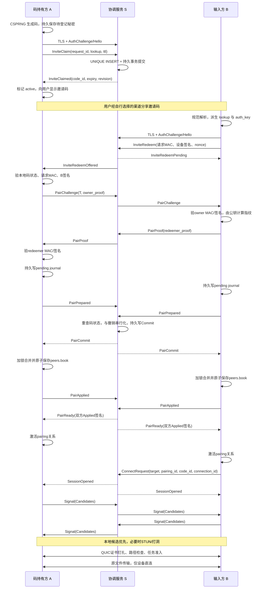
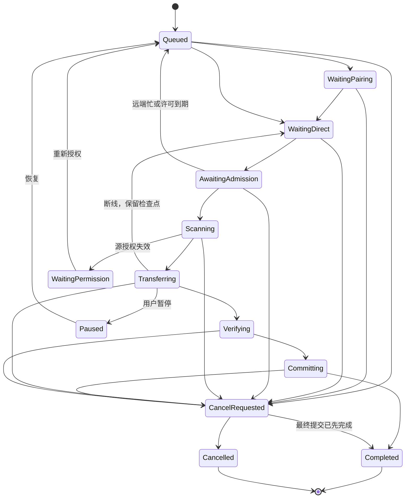

## A. 协调面协议设计

以下是拟冻结的开发方案，尚未实施。本次仅做只读审阅，没有修改文件、运行构建或测试。仓库记录的第十七波基线是 **Rust 507 项、Dart 85 项、Flutter 84 项测试通过**；它们是历史证据，不能当成本方案的验证结果。

### A.1 现有实现与本次扩展边界

当前 `ak-signal` 的实际状态是：

- 控制连接为**明文 TCP，加客户端 Hello 的 Ed25519 签名**，没有 TLS 服务端认证。
- 控制帧格式为 `[version:u8][type:u8][payload_len:u16 BE][payload]`，全帧上限 4096 字节。
- `CtrlMessage` 类型值为 1–8；`PeerSignal` 子类型值为 1–4。
- `DeviceId` 是 **32 字节 Ed25519 公钥**，不是指纹字符串。指纹应由客户端根据收到的公钥重新计算。
- 服务端在线设备与 session 都是内存状态，没有长期邀请码注册库。
- `ConnectRequest { target }` 会按两个设备复用 session，不能直接区分“同一对设备使用多个邀请码建立的连接”。
- `Register` 保存候选地址，`SessionOpened` 返回对端公钥；**当前不会自动把已经注册的候选交换给双方**。
- `SignalClient::next()` 消费一个共享无界 inbox，不能让多个兑换、连接任务各自竞争读取。
- 同一设备重新登录会替换旧控制连接。因此 CLI 配对命令必须复用常驻运行时，避免把 daemon 的控制连接挤掉。

本次扩展只允许协调服务处理以下内容：

> 公开设备身份、邀请码查找摘要、固定长度认证证明、配对事务状态、连接候选与打洞参数。

文件正文、密文、路径、文件名、清单、内容摘要、文件任务进度均不进入协调面。后文的 `transcript_digest` 是**配对握手记录摘要**，不是文件摘要。

### A.2 命名、码格式与生成方

**新功能统一命名为“配对邀请码”，代码类型使用 `InviteCode`，字段使用 `invite_code`。**

现有 `pairing_code(fingerprint)` 生成的 `123-456` 保持兼容，界面与文档改称“指纹核对短码”。新邀请码不能进入旧的六位码解析分支，也不能成为 `receive.expect` 的另一种隐式准入值。

建议冻结以下格式：

| 项目 | 决定 |
|---|---|
| 随机源 | 客户端操作系统 CSPRNG，Rust 使用 `OsRng` |
| 随机内容 | 20 字节，160 bit 熵 |
| 编码 | Crockford Base32，32 个有效字符 |
| 字符集 | `0123456789ABCDEFGHJKMNPQRSTVWXYZ` |
| 展示格式 | `AKI1-XXXX-XXXX-XXXX-XXXX-XXXX-XXXX-XXXX-XXXX` |
| 规范化 | ASCII 小写转大写；仅接受规定位置的 `-` 或无分组形式 |
| 拒绝 | Unicode 同形字符、控制字符、任意空白、错误长度、未定义字符 |
| 有效时间 | 默认长期有效；可选择短期 TTL |
| 生效节点 | 服务端持久 claim 成功后才显示为“有效” |

`AKI1` 是格式版本，不计入随机熵。不使用现有 `ak-signal::util::unique_bytes` 生成邀请码或认证 nonce：它是时钟与计数器派生工具，不是密码学随机源。

**推荐客户端生成、服务端登记。**

| 方案 | 优点 | 代价与决定 |
|---|---|---|
| 客户端生成 | 服务器无需知道明文邀请码；可以利用邀请码在两端验证公钥交换 | 必须实现持久 claim、碰撞重试、请求幂等；采用 |
| 服务端生成 | 唯一性分配与返回流程较简单 | 服务器接触全部配对凭证；数据库、日志或服务端被侵入时风险扩大；不采用 |

随机性用于防猜测，**唯一性由权威数据库事务保证**，不能把“碰撞概率很低”写成“绝不重复”。

### A.3 全局唯一性、持久化与撤销

#### 1. 全局唯一性的范围

本产品采用**一个权威邀请码命名空间**。所有提供邀请码登记功能的服务实例，必须使用同一个权威注册服务及其一致性存储。

首版推荐：

- 单活注册服务。
- 本地 SQLite 权威库，事务开启持久同步。
- 独立服务进程持有数据库所有权锁。
- 不在共享网络文件系统上把多个 SQLite 副本拼成多活。
- 无法访问权威库时拒绝发出有效邀请码。

互不通信的独立服务器不可能只靠随机数保证世界范围绝对不重复。因此首版不支持“每个私服独立发行相同格式、同时声称全局唯一”。未来支持私服时，应统一接入权威注册，或者在**完整邀请码**中加入由权威唯一分配的发行方命名空间。

#### 2. 服务端不接收、不保存明文邀请码

建议使用域分离的派生值：

```text
lookup_digest = BLAKE3_DERIVE_KEY("AK invite lookup v1", secret20)
auth_key      = BLAKE3_DERIVE_KEY("AK invite authentication v1", secret20)
```

服务器只接收 `lookup_digest`。`auth_key` 留在两个端点，用于后续固定握手记录的 MAC。

**不能直接把 `lookup_digest` 当成配对凭证。** 知道 lookup 的攻击者可以提交受限的查找请求，但不能生成端点所需的认证证明。

服务端数据库建议：

```text
invite_codes
  lookup_digest       BLOB(32) PRIMARY KEY
  code_id             BLOB(16) UNIQUE NOT NULL
  owner_device_id     BLOB(32) NOT NULL
  created_unix_ms     INTEGER NOT NULL
  expires_unix_ms     INTEGER NULL
  state               active | revoked | expired
  revision            INTEGER NOT NULL
  create_request_id   BLOB(16) NOT NULL

  UNIQUE(owner_device_id, create_request_id)
```

另外需要：

- `pairing_transactions`：固定配对 transcript、双方证明、Prepared/Commit/Applied 状态。
- `pairing_relations`：已完成配对的 owner/redeemer、公钥、`code_id` 与 `pairing_id` 关联。
- 有界请求幂等记录和 schema 版本。
- 不保存文件任务记录、路径、内容或文件进度。

#### 3. 并发 claim

claim 的线性化点是**唯一索引保护下的 INSERT 事务提交**：

1. 客户端生成码并安全保存“待登记”记录。
2. 发送 `InviteClaim`。
3. 服务端根据已认证连接确定 owner，执行事务插入。
4. 同一码同时 claim，最多一个不同登记请求成功；其余返回 `CODE_CONFLICT`。
5. 客户端遇到真正碰撞后重新生成，单次操作最多重试 8 次。
6. 网络超时不直接生成新码；先以原 `request_id` 重试，获取同一次提交的结果。

幂等规则：

- 同 owner、同 `request_id`、同请求内容：返回原结果。
- 同 owner、同 `request_id`、不同内容：拒绝 `REQUEST_CONFLICT`。
- 同 lookup、不同请求：不能覆盖原 owner。
- 哈希碰撞最多导致新码登记失败，不能导致两个有效记录同时出现。

#### 4. 长期有效、过期与复用

推荐**撤销、过期后也不复用旧码**：

- 保留最小 tombstone，至少包含 lookup、终态及必要版本信息。
- 不允许通过删除记录重新激活旧码。
- 避免用户从旧聊天记录复制一个已经被分配给陌生设备的码。
- 160 bit 空间足够大，没有依赖复用节省号码的必要。

TTL 分开定义：

| 对象 | 生命周期 |
|---|---|
| 邀请码 | `ttl_secs=0` 表示长期；有限 TTL 为 60 秒至 30 天 |
| 一次 redeem 尝试 | 最长 120 秒 |
| 未提交配对事务 | 到期后可以 Abort |
| 已持久 Commit 的事务 | 必须恢复到完成或明确人工处理，不能按普通 TTL 丢弃 |
| 候选协调 session | 保持现有默认 120 秒 |
| 已建立的数据直连 | 不依赖邀请码 TTL 或协调 session 存活 |

过期判断在每次 redeem 与 Commit 事务内执行，不能只依赖定时清扫。已经进入 expired/revoked 的状态不可因时钟回拨恢复 active。服务器检测到异常时钟回退或数据库恢复缺口时，应停止发行和新的配对提交，先完成状态核对。

从旧备份恢复后，不能立即继续发码并声称唯一性完整；必须恢复全部已确认登记及撤销记录，或保持发行关闭。

#### 5. 撤销含义

- **撤销邀请码**：阻止后续兑换。
- **移除配对设备**：撤销本地设备信任，阻止该设备的新任务。
- **取消任务**：停止某一传输实例。

三者独立。

撤销与配对 Commit 在同一权威事务域内排序：

- Revoke 先提交：尚未 Commit 的配对失败。
- Commit 先提交：此次配对保留；后续撤码不自动删除双方 `peers.book`。
- owner 离线撤码：先在本地持久标记“停用”，停止响应兑换；界面显示“服务器撤销待同步”，不能提前声称全局撤销成功。

### A.4 控制协议 v2：确切变体、字段与预算

采用独立 `codec::v2::CtrlMessage`，保留 v1 解码器及其原始布局。新邀请码功能仅通过 **TLS 控制协议 v2** 使用，不自动降级明文。

冻结的基础规则：

- 帧头仍为 4 字节，帧版本为 `2`。
- 全帧仍不超过 **4096 字节**。
- 下表预算都是 **payload 字节数，不含 4 字节帧头**。
- 整数为大端编码；固定数组不带长度前缀。
- 未定义 tag、非法方向、非法状态、尾随字节全部拒绝。
- 先验证类型和长度预算，再分配。
- 新编码入口使用可返回错误的 `try_encode`，不能靠截断长度或仅有 `debug_assert` 保证正确性。

类型别名：

```rust
type RequestId    = [u8; 16];
type CodeId       = [u8; 16];
type PairingId    = [u8; 16];
type ConnectionId = [u8; 16];
type SessionId    = [u8; 16];

type DeviceId     = [u8; 32]; // Ed25519 公钥
type RegistryId   = [u8; 32]; // 权威服务身份
type Digest32     = [u8; 32];
type Nonce32      = [u8; 32];
type Mac32        = [u8; 32];
type Signature64  = [u8; 64];
```

所有随机 ID 与 nonce 使用 CSPRNG；数据库中的 ID 另有唯一约束。全零 ID 保留为分页起止等明确哨兵，不发行给真实对象。

#### 1. 既有流程在 v2 中的布局

| Tag | `CtrlMessage` 变体 | 字段，按编码顺序 | Payload 预算 |
|---|---|---|---:|
| `0x01` | `Hello` | `version:u16, device_id:32, name:u16长度+≤64B, timestamp_ms:u64, challenge:32, signature:64` | ≤204 |
| `0x02` | `Welcome` | `session_ttl_secs:u32, capabilities:u32` | 8 |
| `0x03` | `Register` | `count:u8, candidates:[SocketAddr; ≤16]` | ≤305 |
| `0x04` | `ConnectRequest` | `request_id:16, target:32, pairing_id:16, code_id:16, connection_id:16` | 96 |
| `0x05` | `SessionOpened` | `session:16, peer:32, pairing_id:16, code_id:16, connection_id:16, expires_ms:u64` | 104 |
| `0x06` | `Signal` | `session:16, signal:PeerSignal` | ≤322 |
| `0x07` | `Cancel` | `session:16` | 16 |
| `0x08` | `ServerError` | `code:u16, message:u16长度+≤128B` | ≤132 |
| `0x09` | `AuthChallenge` | `registry_id:32, nonce:32, expires_ms:u64` | 72 |

这些是 **v2 布局**。不能将扩展字段直接追加到现有 v1 帧后，让旧解码器猜测。

`SocketAddr` 延续现有编码：地址族 1 字节、IPv4/IPv6 地址 4/16 字节、端口 2 字节，因此每项最大 19 字节。端口 0 拒绝。

`ServerError` 保留有界旧类错误；邀请码业务错误走下面的固定 `PairError`，不回显用户输入。

#### 2. 邀请码管理消息

`InviteSummary` 固定为：

```text
code_id[16] | state:u8 | created_ms:u64 | expires_ms:u64 | revision:u64
```

共 41 字节。这里 `expires_ms=0` 表示长期有效。

| Tag | 变体 | 字段 | Payload 预算 |
|---|---|---|---:|
| `0x0A` | `InviteClaim` | `request_id:16, lookup_digest:32, ttl_secs:u32` | 52 |
| `0x0B` | `InviteClaimed` | `request_id:16, code_id:16, created_ms:u64, expires_ms:u64, revision:u64` | 56 |
| `0x0C` | `InviteList` | `request_id:16, cursor:16, limit:u8, state_filter:u8` | 34 |
| `0x0D` | `InviteListPage` | `request_id:16, next_cursor:16, count:u8, entries:[InviteSummary; ≤32]` | ≤1345 |
| `0x0E` | `InviteRevoke` | `request_id:16, code_id:16, expected_revision:u64` | 40 |
| `0x0F` | `InviteRevoked` | `request_id:16, code_id:16, revision:u64, revoked_ms:u64` | 48 |

约束：

- owner 从已认证控制连接推导，不能由请求任意指定。
- list 只列本设备创建的码。
- list 不返回明文码、lookup、MAC 或服务器上的私有路径。
- 本地备注不进入协调协议。
- `state_filter` 仅接受已定义位；`limit` 为 1–32。
- 只有 owner 可以 revoke。访问他人的 `code_id` 与不存在的 ID 返回相同不可用错误。

#### 3. 配对 transcript 与证明

冻结 `PairTranscript`，共 **256 字节**：

```text
registry_id[32]
code_id[16]
code_revision:u64
pairing_id[16]
request_id[16]
lookup_digest[32]
owner_device_id[32]
redeemer_device_id[32]
owner_nonce[32]
redeemer_nonce[32]
deadline_ms:u64
```

冻结：

```text
PairProofData = mac[32] + signature[64]     // 96 字节
```

MAC 和签名覆盖明确的角色域及完整规范 transcript：

```text
owner_mac = MAC(auth_key, "AK owner proof v1" || transcript)
redeemer_mac = MAC(auth_key, "AK redeemer proof v1" || transcript)

signature = Ed25519.Sign(
    device_key,
    对应角色域 || transcript || mac
)
```

使用库提供的成熟 MAC/派生实现和恒定时间验证接口，不手写密码学原语。整个认证协议仍需独立审阅与固定测试向量，不能仅凭采用成熟哈希算法就宣称协议已经被证明安全。

#### 4. Redeem 与双侧落簿消息

| Tag | 变体 | 字段 | Payload 预算 |
|---|---|---|---:|
| `0x10` | `InviteRedeem` | `request_id:16, lookup_digest:32, redeemer_nonce:32, deadline_ms:u64, request_mac:32, signature:64` | 184 |
| `0x11` | `InviteRedeemPending` | `request_id:16, pairing_id:16, deadline_ms:u64` | 40 |
| `0x12` | `InviteRedeemOffered` | `code_id:16, code_revision:u64, pairing_id:16, redeemer_device_id:32, redeem:InviteRedeem的固定字段` | 256 |
| `0x13` | `PairChallenge` | `transcript:256, owner_proof:96` | 352 |
| `0x14` | `PairProof` | `pairing_id:16, transcript_digest:32, redeemer_proof:96` | 144 |
| `0x15` | `PairPrepared` | `pairing_id:16, transcript_digest:32, signature:64` | 112 |
| `0x16` | `PairCommit` | `transcript:256, owner_proof:96, redeemer_proof:96, owner_prepared_signature:64, redeemer_prepared_signature:64, commit_revision:u64` | 584 |
| `0x17` | `PairApplied` | `pairing_id:16, transcript_digest:32, commit_revision:u64, signature:64` | 120 |
| `0x18` | `PairReady` | `pairing_id:16, transcript_digest:32, commit_revision:u64, owner_applied_signature:64, redeemer_applied_signature:64` | 184 |
| `0x19` | `PairStatusQuery` | `request_id:16, pairing_id:16` | 32 |
| `0x1A` | `PairStatusReply` | `request_id:16, pairing_id:16, state:u8, commit_revision:u64, deadline_ms:u64` | 49 |
| `0x1B` | `PairAbort` | `request_id:16, pairing_id:16, reason:u16` | 34 |
| `0x1C` | `PairError` | `request_id:16, scope:u8, object_id:16, code:u16, retry_after_ms:u32` | 39 |
| `0x1D` | `Ping` | `nonce:16` | 16 |
| `0x1E` | `Pong` | `nonce:16` | 16 |

`scope`、`state`、`reason` 都是封闭枚举。`InviteRedeemOffered.redeem` 是固定结构，不能实现为字节数组或通用嵌套消息。

状态恢复规则：

- `PairStatusQuery` 仅允许配对参与方查询。
- 已 Commit/Ready 的事务，服务端在状态回复后重发对应的固定 `PairCommit`/`PairReady`。
- 不增加 `extra_json`、`metadata`、`attachment` 等扩展口。
- 对合法但不存在或无权查询的对象，返回统一不可用结果。

#### 5. `PeerSignal` 子类型

本功能**不向 `PeerSignal` 增加邀请码或通用认证载荷**。配对消息由上面的明确 `CtrlMessage` 变体承载。

| 子 tag | 变体 | 编码内容 | 含子 tag 的最大字节数 |
|---|---|---|---:|
| `0x01` | `Candidates(Vec<SocketAddr>)` | tag、数量、至多 16 个地址 | 306 |
| `0x02` | `PunchAt { epoch_unix_ms, nonce }` | tag、u64 时间、8B nonce | 17 |
| `0x03` | `Bye` | tag | 1 |
| `0x04` | `SameEgress` | tag | 1 |

`SameEgress` 仍只能由服务端生成，仍只是排序提示。它不证明两端位于可信局域网。

封闭集测试应穷举全部 256 个 tag，分别验证版本、类型、方向、长度和状态限制；不能仅把原来的“1–8 合法”改成一个更大的连续范围后结束测试。

### A.5 TLS、身份互证与完整 redeem 时序

#### 1. TLS 是必要前置条件

新控制连接使用 TLS，验证协调服务身份，并绑定固定的 `RegistryId`。首版可采用明确配置的服务端证书公钥 pin；不得自动接受未知 pin，也不得降级现有明文 TCP。

Hello v2 的签名绑定：

```text
"AKHELLO2"
|| registry_id
|| TLS exporter
|| Hello 规范字段（不含 signature）
```

服务端先发 `AuthChallenge`，challenge 只能在当前 TLS 连接上使用一次，最长有效 10 秒。保留设备名 C0/DEL/C1 拒绝、Hello 新鲜度、重放缓存和帧限频。

TLS 解决链路窃听与假协调端问题；**仅有 TLS 不足以防止被入侵的协调服务替换首次配对公钥**，因此还需要邀请码派生的双端证明。

#### 2. 码本身即授权，owner 必须在线自动处理

推荐首版语义：

- 创建并分享邀请码，就是允许持码者与本设备配对。
- owner 不需要再次手动点击同意。
- owner 必须在线，由本地运行时验证证明并落簿。
- 长期有效表示凭证不会自动过期，不表示设备离线时服务器可以代替它写信任簿。
- owner 离线时本次尝试进入等待并按期限失败，客户端可退避重试。

同一码允许 owner 与多个 redeemer 分别配对。B、C 都兑换 A 的码，只产生 A↔B 和 A↔C 信任；不产生 B↔C 信任，也不允许 A 替它们转发文件。

#### 3. 时序图



初始 `request_mac` 覆盖发行方、lookup、B 公钥、请求 ID、B nonce 和 deadline。owner 必须先验证它，才返回自己的身份与完整证明。

#### 4. 防中间人的实际保证

双方各自验证：

1. 收到的公钥具有有效的设备签名。
2. MAC 证明对端知道邀请码秘密。
3. transcript 绑定了双方身份、角色、发行方、码、请求、配对事务、双 nonce 与期限。
4. 指纹由公钥本地计算。
5. 已有信任不能因服务端返回新公钥而被静默替换。
6. 实际 QUIC 连接还要通过既有 DER、自签名、指纹钉扎与路径闸门。

因此，仅掌握服务端数据库 lookup 的攻击者，或者不知道邀请码秘密的恶意协调服务，不能单独伪造端点证明并让双方落簿。

邀请码是 bearer credential：码泄露后，持有者具有配对能力。不能继续承诺该码可区分“原本想邀请的人”和“窃取了码的人”。需要核验具体人的场景，仍可独立核对完整设备指纹。

#### 5. 两侧落簿不是跨机器原子事务

`PeerBook::save` 的原子替换只保护一个本地文件，不代表两个设备同时写入，也不保护并发 read–modify–write。

需要新增统一的事务式更新入口，例如：

```rust
PeerBookStore::apply_pairing(
    &self,
    verified: &VerifiedPairing,
) -> Result<ApplyOutcome, PeerBookError>;
```

要求：

- 文件锁覆盖读取、合并、保存全过程。
- CLI 手工 add/import/remove、FFI `ak_peer_*`、自动配对统一走该入口。
- 坏簿不能被当成空簿覆盖。
- 已有本地名称与首次配对时间按明确规则保留。
- 本地 journal 记录 Prepared、CommitSeen、BookApplied、Ready。
- 新增记录在 `PairReady` 前不能通过邀请码路径放行任务；准入同时检查配对 journal，不能只看 `book.get(fp).is_some()`。
- 延迟 Commit 不能复活用户已经移除的信任；用本地信任版本或 tombstone 拒绝旧事务重放。
- 一侧写失败时显示“配对尚未完成”；已 Commit 的事务重连后继续恢复，不能超时假报成功或盲目删除另一侧已保存的数据。

#### 6. 进入既有候选交换的方式

保留 `ConnectRequest → SessionOpened → Signal` 的流程，但 v2 session 按已验证的：

```text
(pairing_id, code_id, connection_id)
```

建立关联，不再只按设备对复用。

双方收到 `SessionOpened` 后，必须**主动发送当前候选**。候选只能指向本设备实际监听、探测所用端点，打洞与 QUIC 尽量复用同一 UDP socket。

仍保持每设备最多 4 个在建协调 session；已完成建连后释放短期协调 session。这个上限限制同时协调的连接数，不需要限制已建立的数据直连总数。

协调 session 结束、邀请码到期或服务器退出，都不得主动中断已经稳定且仍获本地授权的数据直连。

### A.6 防暴力、防枚举与既有安全边界叠加

建议默认预算：

| 层级 | 默认限制 |
|---|---|
| 既有帧限频 | 保持每连接 32 帧/秒、突发 64 |
| redeem 每设备 | 5 次/分钟，30 次/小时 |
| redeem 每 IP / IPv6 前缀 | 60 次/分钟，另有全局限额 |
| 同时 pending redeem | 每发起设备 4、每 owner 32、全局 4096 |
| 邀请码创建 | 每 owner 6 次/小时 |
| active 邀请码 | 每 owner 32 |
| 名下配对关系 | 有界存储配额，建议首版 1024；达到上限明确拒绝 |
| TLS / 未认证连接 | 独立握手并发、IP 预算、首帧与写入 deadline |
| 客户端请求 map / 收件箱 | 有界，取消、完成、超时立即回收 |
| 服务端 outbox | 保持有界；写入超时断开慢消费者 |

设备密钥可以批量生成，设备限速不能独立承担防暴力；必须叠加 IP、前缀、owner 与全局资源预算。共享出口可能误伤正常用户，限速提示允许重试，但不能据此放开凭证强度或消息预算。

**错误响应取舍：**

- 格式错误在本地拒绝。
- 配额拒绝在 lookup 查询前执行，返回 `RATE_LIMITED` 或 `RESOURCE_LIMIT`。
- 不存在、错误、过期、撤销、owner 离线、MAC 无效，兑换方最终统一看到 `PAIR_UNAVAILABLE`。
- 初始 `InviteRedeemPending` 对存在与不存在的码使用相同字段形状。
- 失败采用统一期限策略，不即时返回“该码存在但对方离线”。
- 成功当然会暴露码可用；不声称完全消除所有时序侧信道。
- owner 查询自己的列表，可以看到真实 active/revoked/expired 状态。
- 错误尝试不得永久锁死或自动撤销别人的长期码，主要处罚发起设备和来源地址。

建议固定业务错误码：

```text
0x2101 PAIR_UNAVAILABLE
0x2102 RATE_LIMITED
0x2103 RESOURCE_LIMIT
0x2104 REQUEST_CONFLICT
0x2105 CODE_CONFLICT
0x2106 REVISION_CONFLICT
0x2107 PROTOCOL_UNSUPPORTED
0x2108 STORAGE_UNAVAILABLE
```

`CODE_CONFLICT` 仅用于高熵随机码登记冲突，不提供公开“检查某码是否存在”的接口。

第十七波边界全部保留，并补充：

- Hello 缓存目前容量满后会逐出条目；新流程不能将其描述为完整重放证明。
- 新 challenge 使用一次即失效；缓存压力下拒绝过载，不能淘汰仍有效的安全记录后继续接受。
- 缓存覆盖合法未来时间戳对应的完整接受区间，补未来时间戳、容量压力和跨连接重放测试。
- 邀请码请求另有 nonce、deadline、request ID 和持久幂等控制。
- 新字符串延续 C0/DEL/C1 规则。
- 日志、`Debug`、FFI 错误、诊断报告不记录邀请码、lookup、MAC 或秘密文件内容。
- 新依赖重新检查 TLS 配置、代理使用、relay 默认值、权限和协议兼容。

### A.7 协调面任务拆分与验证

公共契约先在第十八波冻结。`ak-signal` 如多人并行，必须先建立下表所列互斥子目录；现有 `lib.rs`、Cargo manifest 与旧入口接线由集成者在收口时独占修改。

| 任务 | 文件所有权边界 | 冻结契约 | 验证门槛 | 依赖与波次 |
|---|---|---|---|---|
| A0 协议与安全契约 | `docs/`，契约负责人独占 | v2 tag、字段、预算、状态机、错误码、威胁模型 | 逐消息大小核算；与 ADR-001/002/003 对照 | 第十八波；后续并行入口 |
| A1 v2 codec | 新 `crates/ak-signal/src/protocol_v2/` | 本节 `CtrlMessage`/`PeerSignal`、编码与方向 | 全变体 roundtrip；全部未知 tag；超长、截断、尾随、非法阶段；生产编码拒绝 | 第十九波，全并行基础任务 |
| A2 TLS、权威库、服务端事务 | 新 `crates/ak-signal/src/server_v2/` | `claim/revoke/list/prepare/commit/status`，SQLite schema | 并发碰撞只成功一次；重启不重码；撤销/Commit 竞态；库满、损坏、慢客户端；TLS 错 pin | 第十九波按契约开发；第二十波接 A1 |
| A3 客户端请求分派 | 新 `crates/ak-signal/src/client_v2/` | 单 reader，按 request/pairing/connection ID 分派 | 多请求不串包；收件箱有界；重连幂等；同身份不挤掉 daemon | 第十九波 Fake server 并行；第二十波真实接线 |
| A4 邀请码与信任簿事务 | `crates/ak-identity/` | `InviteCode`、typed transcript、验证结果类型、`PeerBookStore` | 角色反射、换公钥、换码、换 nonce、过期证明；并发落簿；DER 原回归 | 第十九波，全并行 |
| A5 配对 journal 与秘密存储 | `crates/ak-store/`；与 B 的同一所有者 | pending/committed/applied/ready、秘密引用、幂等恢复 | 每个落盘边界崩溃恢复；坏记录失败关闭；不污染文件检查点 | 第十九波，全并行 |
| A6 自动配对编排 | 新 `crates/ak-session/src/pairing/` | 收证、写 journal、落簿、Ready、撤销同步 | 服务器单独换钥失败；只一侧写成功不显示完成；延迟 Commit 不复活信任 | 第二十波 Fake 开发；第二十一波实接 |
| A7 配对集成场景 | `crates/ak-itests/`，同一集成测试所有者 | 双真实 runtime＋TLS server＋真实文件系统 | 发码→兑换→双侧落簿→直连；碰撞、暴力、重放、断电、服务器失陷模拟 | 第二十波搭建；第二十二至二十四波验收 |

服务器持久库建议放在 `ak-signal` 的 `server-persistence` 特性后，默认关闭。移动客户端不因启用邀请码而被迫链接服务器 SQLite 后端。

---

## B. Rust 调度层

### B.1 明确推荐：新增共享 `ak-session` crate

**推荐新增 `ak-session`，其中包含 `scheduler`、`pairing`、`runtime` 模块。CLI 与 FFI 共用它。**

不把产品调度策略分别放在 CLI daemon 和 Flutter，也不把邀请码生命周期塞进文件协议引擎。暂不额外拆第二个 `ak-scheduler` crate：当前配对关系、连接生命周期与队列高度相关，在一个共享应用层中划分模块更容易保持一致。

依赖方向：

```text
ak-cli ─┐
        ├── ak-session ── ak-signal
ak-ffi ─┘       │        ak-identity
                │        ak-store
                └────── ak-engine ── ak-net / ak-wire / ak-storage
```

职责明确为：

| 模块 | 职责 |
|---|---|
| `ak-session::pairing` | 邀请码与配对事务编排，消费已验证的身份材料 |
| `ak-session::scheduler` | 两维并发策略、队列、背压、公平性、任务准入 |
| `ak-session::runtime` | 单身份运行时、常驻监听、信令分派、重试、取消、关闭 |
| `ak-engine` | 一次任务的单流/多流文件协议执行 |
| `ak-store` | 本地队列、配对 journal、恢复映射 |
| `ak-storage` | 每任务 staging、路径安全、目标竞争与最终提交 |
| CLI / FFI / Dart / GUI | 提交命令、观察状态与展示结果 |

当前源码没有公开 `serve` 函数；实际入口是 `receive`、`receive_with_addr` 和 `serve_concurrently`。

### B.2 两维并发的确切语义

定义分组键：

```text
CodeGroupKey = (registry_id, code_id)
```

一码对应一个 owner。owner 对这个码产生的所有关系统一执行同码策略，包括：

- A→B；
- B→A；
- A→C；
- C→A。

不能把同一码拆成“每个对端各串行一次”，否则 B、C 同时向 A 发送时仍会突破“同码串行”。

| `same_code_mode` | `cross_code_mode` | 实际行为 |
|---|---|---|
| `serial`，默认 | `parallel`，默认 | 每码最多一个活跃任务，不同码可同时传输 |
| `parallel` | `parallel` | 同码及不同码均可并行，受资源上限约束 |
| `serial` | `serial` | 只有一个活跃码组，该组一个任务 |
| `parallel` | `serial` | 只有一个活跃码组，该组内部可运行多个任务 |

这里“不同码的连接串行”限制的是**进入传输服务的活跃码组**。TLS 信令连接、短期地址探测和有界的待准入握手单独计数；配对关系本身不会因串行模式被删除。界面不能把逻辑连接数量与 UDP socket、QUIC connection 数量混为一谈。

建议配置：

```json
{
  "same_code_mode": "serial",
  "cross_code_mode": "parallel",
  "max_active_tasks": 8,
  "max_active_tasks_per_code": 4,
  "max_active_code_groups": 4,
  "max_queued_tasks": 256,
  "max_queued_tasks_per_code": 64,
  "max_pending_admissions": 32
}
```

范围：

- `max_active_tasks`：1–64。
- `max_active_tasks_per_code`：1–16，且不超过全局任务上限。
- `max_active_code_groups`：1–16。
- `max_queued_tasks`：1–4096。
- `max_queued_tasks_per_code`：1–512，且不超过全局队列上限。
- `max_pending_admissions`：1–64。

serial 模式覆盖对应并行上限。两端策略取交集：一端允许并行、另一端要求串行，实际必须串行。响应与 UI 返回“配置策略”和“当前有效限制”，不能只改本地开关。

同一码已经配对多个设备时，发送任务必须明确选择 `pairing_id` 对应的目标；输入码不意味着广播给所有已兑换设备。

### B.3 与 `serve_concurrently` 的关系

当前：

```rust
serve_concurrently(spec, expected_jobs, progress)
    -> Vec<Result<Report, EngineError>>
```

`expected_jobs` 表示**这一轮总共接受并结束多少个连接**，不是最大并发数。当前行为是：

- 一次 bind。
- 每个连接一个文件任务。
- 接满 N 个连接后等待它们结束。
- 没有持续服务的停止通道。
- 内部存在无界进度通道。
- FFI 并发接收取消还需要 loopback knock 唤醒 detached accept。

计划保留其外部语义，作为兼容批处理入口。不得把 `receive --jobs N` 悄悄解释成新调度器并发上限。

新 runtime 提供常驻监听能力：

```rust
SessionRuntime::start(config) -> Result<SessionHandle, SessionError>;

SessionHandle::enqueue(spec) -> Result<TransferId, SessionError>;
SessionHandle::set_policy(policy) -> Result<PolicyRevision, SessionError>;
SessionHandle::cancel(transfer_id) -> Result<(), SessionError>;
SessionHandle::retry(transfer_id) -> Result<(), SessionError>;
SessionHandle::snapshot(query) -> Result<SessionSnapshot, SessionError>;
SessionHandle::shutdown(mode) -> Result<(), SessionError>;
```

引擎提取以下能力，所有旧入口继续调用同一文件协议内核：

```rust
send_on_channel(...)
receive_on_channel(...)
```

实际签名需包含：

- 已认证的 `DirectChannel`；
- 已完成任务准入的上下文；
- 稳定 `transfer_id`；
- 文件任务 spec；
- 取消令牌；
- 进度接收器。

其中准入上下文通过受控构造函数产生，不能由调用方填一个 `authorized: true` 绕过验证。引擎入口仍执行 `gate_channel`，不能因为上层已经检查过就删掉防御。

**首版保持一任务一个 QUIC connection。** 同码并行会建立多个任务连接；任务内 `multistream` 是独立设置，不用于表达跨任务并发。

### B.4 队列、背压、双端准入与公平性

#### 1. 队列结构

建议运行时由一个 scheduler actor 串行管理状态：

```rust
struct SchedulerState {
    groups: HashMap<CodeGroupKey, GroupQueue>,
    ready_groups: VecDeque<CodeGroupKey>,
    tasks: HashMap<TransferId, TaskEntry>,
    running: HashMap<TransferId, RunningTask>,
    pending_admissions: HashMap<AdmissionId, AdmissionEntry>,
    policy: SchedulingPolicy,
    policy_revision: u64,
}

struct GroupQueue {
    pending: VecDeque<TransferId>,
    active: HashSet<TransferId>,
    batch: Vec<TransferId>,
}
```

外部命令经有界 `mpsc` 输入，状态转换由 actor 统一处理。网络 I/O、文件扫描、落盘不能占着全局调度锁等待。

排队项保存源引用、目标关系、参数与状态；**不预扫描全部文件，不生成完整 manifest，不打开文件 sink**。当前 `send` 在连接前扫描源，需要拆出这一阶段，获得准入之后再执行。

#### 2. 双端任务准入

单靠发送端排队不够，多个 redeemer 可以分别向同一 owner 发起任务。因此需要设备直连上的任务准入。

在 `ak-wire` 新增 capability `CAP_TASK_ADMISSION`，协商后使用封闭消息：

```text
TaskOpen
  registry_id[32]
  code_id[16]
  pairing_id[16]
  transfer_id[16]
  direction:u8
  attempt:u32
  admission_nonce[16]

TaskAdmission
  transfer_id[16]
  admission_nonce[16]
  decision:u8          // ready | queued | rejected
  permit_id[16]
  lease_ms:u32
  retry_after_ms:u32
  reason:u16

TaskAdmissionAck
  transfer_id[16]
  permit_id[16]
  admission_nonce[16]
```

这组消息只经设备直连传输，**不经 `ak-signal`**。

收到 `TaskOpen` 后：

1. 核对真实 `DirectChannel.peer_fingerprint()`。
2. 核对本地 Ready 配对关系、owner、`code_id` 与 `pairing_id`。
3. 申请 owner 的同码许可及两端资源许可。
4. 双端确认许可后，才扫描文件并进入 Offer/Manifest/Chunk。

不能允许客户端任意填写陌生 `code_id` 获得另一条队列。

双方同时发送时，采用短期 tentative permit、固定设备身份排序和有界 lease：

- 每端一次性预留自己的全局及组资源，避免内部锁顺序不一致。
- 双端按稳定身份顺序完成预留。
- 未完成双方确认立即或到期释放，不持有一端资源无限等待另一端。
- 冲突按稳定任务排序及退避处理，测试相向发送和多组竞争，防止死锁或持续互相让步。

新邀请码任务遇到不支持 capability 的旧端，返回 `PROTOCOL_UNSUPPORTED`，不能退回无分组准入的路径。旧的明确手工指纹传输继续使用原协议。

修改 `ak-wire` 时必须同步 `ak-net` 的逐类型读取预算表，否则会出现解码器支持新帧、网络层却拒绝或错误分配的问题。

#### 3. 背压

- 本地队列满：enqueue 立即返回 `QUEUE_FULL`，不扫描、不创建连接、不自动丢旧任务。
- 每码队列满：只拒绝该码的新任务，不阻塞其他码。
- 远端准入队列满：返回有界 `BUSY`/retry hint，发送端保留本地队列项。
- 等待直连、等待远端许可时不长期占用传输 slot。
- 进度事件允许合并，但终态必须能通过任务查询补取。
- 慢 UI 或停止轮询不能导致内存无限增长。
- 高并发状态下不能沿用 Flutter 当前“超过 16 条直接移除最早发送记录”的行为；所有活动任务必须保持可查询和可取消。

#### 4. 公平性与切换

- 同组 FIFO。
- 组间轮转。
- 跨码 serial 时采用有限批次：本轮选定任务后，后续追加进入下一批，避免热码永远占用。
- 一个任务的文件内容传输开始后不因轮转强制中断。
- `serial → parallel`：立即按上限补启动。
- `parallel → serial`：进入 `draining`，停止新增超限任务，已运行任务自然结束后收敛。
- 不改变任务 ID，不重新配对，不因为切模式丢弃 checkpoint。
- 用户暂停需要释放调度许可时，停止该任务连接并保留检查点；恢复重新排队和准入。不能保持一个长期暂停任务霸占 serial 组。

### B.5 状态机、取消与运行时生命周期



配置的等待预算与文件传输 `idle_timeout` 分离。正常排队 10 分钟不能被“30 秒没有文件帧”判定失败。

取消分层：

| 操作 | 语义 |
|---|---|
| 取消排队任务 | 移除队列项，持久记录 Cancelled，不建立连接 |
| 取消建连/准入 | 取消该连接尝试，释放 tentative permit |
| 取消活动任务 | 通知引擎取消，停止控制与文件子任务，等待退出，保留可恢复数据 |
| 停止接收监听 | 不再接纳新任务；是否完成在途任务由 `drain/cancel` 模式明确选择 |
| 停止配对控制服务 | 关闭信令和新的配对操作；不连带关闭稳定的数据直连 |
| 关闭 runtime | 停接单、处理队列、取消或 drain、等待所有子任务退出，再释放端口 |

取消与最终提交竞争时，以已发生的持久状态为准。不能向用户报告“已取消”，同时后台继续把任务标记成功。

新的 listener 必须提供显式 stop + join，消除 detached accept 的关闭缺口。迁移后继续验证第十七波已有的取消后端口释放能力。

### B.6 持久化、恢复与任务身份

#### 1. 推荐持久化排队任务

默认持久化，因为长期码与常驻 daemon 的使用方式要求重启后仍可看到未完成任务。

本地记录包含：

```text
schema_version
transfer_id
request_id
registry_id / code_id / pairing_id
peer_fingerprint
direction
source_refs / target_ref
transfer_options
state
enqueue_sequence
policy_revision
checkpoint_record_id
last_stable_error_code
```

源路径、目标路径是**本地私有数据**，仅写用户身份目录，不写协调数据库、日志或仓库。

恢复规则：

- 尚未运行的本地队列项恢复为 Queued。
- 上次运行中的任务恢复为 WaitingDirect/待恢复状态。
- 重新检查源文件、目录权限、配对关系和目标权限。
- 不恢复旧 QUIC 连接、候选可信结论或旧许可。
- Android 授权失效进入 WaitingPermission。
- 已取消任务不自动复活。
- 持久 Completed 仍必须晚于最终校验与提交。
- 提供 `--no-persist-queue` 临时模式，并明确进程退出后排队项丢失。

服务器不保存传输队列。接收端保存已经启动任务的检查点；远端尚未获准的请求可保持有界临时状态，由发送端恢复后重新提交。

#### 2. 保留并加强 record_id 隔离

第十七波已有：

```text
wire_job_id = 内容身份

record_id = BLAKE3(
  content_id || peer || direction || root
)[..16]
```

它解决不同对端、方向、根目录之间的覆盖，但两个“同源、同对端、同目标”的独立并行任务仍可能得到同一记录键。

新任务增加随机、持久的 `transfer_id`：

- 用户每次提交新任务生成新实例。
- 同实例重试沿用。
- 用户“再发送一份”生成新实例。
- 新记录采用 `AKREC2` 域分离，包含 `transfer_id` 和现有全部身份维度。
- 原 `AKREC1` 恢复兼容保留，不能把一个旧记录同时分配给两个实例。
- FFI 与 CLI 明确区分 `task_id/transfer_id`、`wire_job_id`、`record_id`、`pairing_id`、`code_id`。

#### 3. 并发前必须处理 `.akpart` 隔离

当前 `.akpart` 主要按目标路径派生。即使 checkpoint 不同，两个任务仍可能打开同一个 part 文件。

因此安全并行的前置任务包括：

```rust
prepare_file_for_transfer(
    entry,
    conflict,
    staging_namespace,
)
```

要求：

- staging 绑定 `transfer_id`，同实例恢复沿用。
- 最终目标名存在独立竞争控制。
- `Fail` 与 `Rename` 都不能共享写入中的 part。
- 取消不能删除其他任务的 part。
- 路径边界和符号链接竞态防护必须落在实际打开/提交操作，不能只替换字符串。
- 继续保留 hard-link no-replace 提交。
- 对不支持可靠原子提交的卷，明确拒绝该能力或实现并验证平台替代；不能默默退回存在覆盖竞态的 rename，然后宣称并行安全。

#### 4. 本地邀请码秘密

`peers.book` 继续只保存公开信任材料。邀请码秘密独立存储，元数据只记录 `secret_ref`。

首版可以沿用现有设备种子文件的保护级别：用户私有身份目录、严格访问权限、排他更新、原子写入，秘密不进入普通导出及日志。必须如实注明：这不能防止已经取得同一用户文件读取权限的攻击者。

存储接口预留系统秘密存储后端；Windows DPAPI、Android Keystore、Linux Secret Service 的接入与验收单独记录，不能把接口存在写成系统保护已经实现。

### B.7 FFI 导出签名草案

沿用 ADR-003：句柄式 C ABI、调用方缓冲区、原生异步执行、轮询取结果。网络等待不能发生在同步 FFI 调用里。

下面的 `runtime_id` 标识 `ak-session` 运行时，`op_id` 标识异步控制操作，`task_id` 标识传输实例，三者都为 16 字节，语义不混用。

```c
typedef struct AkEngine AkEngine;

/* 初始化共享运行时，后台启动控制连接；返回不代表已经在线。 */
int32_t ak_pairing_start(
    AkEngine *engine,
    const char *spec_json,
    uint8_t runtime_id_out[16]
);

int32_t ak_pairing_create_start(
    AkEngine *engine,
    const uint8_t runtime_id[16],
    const char *spec_json,
    uint8_t op_id_out[16]
);

int32_t ak_pairing_redeem_start(
    AkEngine *engine,
    const uint8_t runtime_id[16],
    const char *spec_json,
    uint8_t op_id_out[16]
);

int32_t ak_pairing_list_start(
    AkEngine *engine,
    const uint8_t runtime_id[16],
    const char *query_json,
    uint8_t op_id_out[16]
);

int32_t ak_pairing_revoke_start(
    AkEngine *engine,
    const uint8_t runtime_id[16],
    const char *spec_json,
    uint8_t op_id_out[16]
);

int32_t ak_pairing_op_result(
    AkEngine *engine,
    const uint8_t runtime_id[16],
    const uint8_t op_id[16],
    char *buf,
    size_t cap
);

int32_t ak_pairing_poll_event(
    AkEngine *engine,
    const uint8_t runtime_id[16],
    char *buf,
    size_t cap
);

int32_t ak_pairing_cancel_op(
    AkEngine *engine,
    const uint8_t runtime_id[16],
    const uint8_t op_id[16]
);

int32_t ak_pairing_stop_start(
    AkEngine *engine,
    const uint8_t runtime_id[16],
    uint8_t op_id_out[16]
);

/* 调度与常驻接收使用同一个 runtime。 */
int32_t ak_sched_listen_start(
    AkEngine *engine,
    const uint8_t runtime_id[16],
    const char *spec_json,
    uint8_t op_id_out[16]
);

int32_t ak_sched_enqueue(
    AkEngine *engine,
    const uint8_t runtime_id[16],
    const char *spec_json,
    uint8_t task_id_out[16]
);

int32_t ak_sched_set_policy(
    AkEngine *engine,
    const uint8_t runtime_id[16],
    const char *policy_json,
    uint8_t op_id_out[16]
);

int32_t ak_sched_cancel(
    AkEngine *engine,
    const uint8_t runtime_id[16],
    const uint8_t task_id[16]
);

int32_t ak_sched_retry(
    AkEngine *engine,
    const uint8_t runtime_id[16],
    const uint8_t task_id[16]
);

int32_t ak_sched_task_result(
    AkEngine *engine,
    const uint8_t runtime_id[16],
    const uint8_t task_id[16],
    char *buf,
    size_t cap
);

int32_t ak_sched_snapshot(
    AkEngine *engine,
    const uint8_t runtime_id[16],
    const char *query_json,
    char *buf,
    size_t cap
);

int32_t ak_sched_poll_event(
    AkEngine *engine,
    const uint8_t runtime_id[16],
    char *buf,
    size_t cap
);

int32_t ak_sched_shutdown_start(
    AkEngine *engine,
    const uint8_t runtime_id[16],
    const char *spec_json,
    uint8_t op_id_out[16]
);
```

冻结事项：

- 所有指针、输入类型和输出 ID 指针检查先于副作用。
- `start` 返回“已受理”，在线、完成、撤销同步等由结果确认。
- `-3 AK_ERR_BUFFER` 不消费事件、不重复生成邀请码、不重复 enqueue。
- 新操作使用 `request_id` 幂等；取结果重复调用只是读取同一结果。
- 保留现有错误码含义；队列满等同步新错误需要明确的新状态码，不能伪装 internal error。
- 配对事件与传输事件分开轮询，避免把无 `job` 字段的配对事件塞进现有进度解析器。
- 同一 native 句柄由一个 Dart isolate 管理，调用串行。
- 每个身份目录只有一个运行时 owner；共享 facade 借用句柄，不重复 dispose。
- 新 ABI 提升版本并公布能力。旧 DLL 缺少新导出时明确不支持，不能让关键字段被旧解析器忽略后继续执行。

JSON 契约示例：

```json
{
  "spec_version": 1,
  "request_id": "<32hex>",
  "ttl_secs": 0
}
```

```json
{
  "spec_version": 1,
  "request_id": "<32hex>",
  "invite_code": "<AKI1邀请码>"
}
```

```json
{
  "spec_version": 1,
  "request_id": "<32hex>",
  "pairing_id": "<32hex>",
  "source_roots": ["<本地路径>"],
  "conflict": "fail",
  "multistream": false,
  "no_internet": false,
  "timeout_secs": 30
}
```

`code_id` 与真实对端从已保存的 `pairing_id` 关系解析，不能让 UI 任意覆写。源码路径不出本地应用层及设备直连。

新监听 spec 的 `expect` 仍必填，推荐显式 `"book"`。空簿时可以先运行配对服务，但文件监听保持未启用或拒绝全部，直到首个 Ready 配对完成；不能通过自动改成 `"any"` 启动。

### B.8 CLI 子命令与 daemon 扩展

建议命令：

| 命令 | 行为 |
|---|---|
| `pair invite [--ttl 10m \| --never]` | 生成并登记邀请码，只有持久 claim 成功后输出 |
| `pair redeem` | 默认交互输入邀请码 |
| `pair redeem --code-stdin` | 从标准输入读取，避免进入 shell 历史和进程参数 |
| `pair list --invites [--all]` | 分页列邀请码元数据；不输出明文秘密 |
| `pair revoke <code-id>` | 撤销邀请码，等待服务器确认或报告待同步 |
| `pair list` | 保持原有配对设备列表语义 |
| `pair code` | 保持旧六位短码功能，输出明确标记“指纹核对短码” |
| `send PATH... --pairing-id <id>` | 经已配对关系提交一个传输任务 |
| `send PATH... --pairing-id <id> --enqueue` | 入队即返回 task ID |
| `sched list` | 查看运行与排队任务 |
| `sched cancel <task-id>` | 取消一个任务 |
| `sched retry <task-id>` | 恢复同一实例 |
| `sched set-policy ...` | 动态修改两维模式并返回生效状态 |

`send PATH1 PATH2` 仍是一个多根任务。要提交两个独立任务，应调用两次或使用以后明确设计的批量入队接口。

新 daemon 参数：

```text
--pairing
--pairing-only
--signal-host HOST
--signal-port PORT
--signal-pin HEX

--same-code-mode serial|parallel
--cross-code-mode parallel|serial
--max-active-tasks N
--max-active-tasks-per-code N
--max-active-code-groups N
--max-queued-tasks N
--no-persist-queue

--expect book|...
--shutdown-mode drain|cancel
```

实施注意：

- 当前 CLI `--expect` 解析并不把字符串 `book` 作为显式分支，需补上并保持原来“省略时使用配对簿”的安全语义。
- `daemon --pairing-only` 允许只提供在线配对能力，不需要启动文件接收。
- CLI 管理命令通过本地 IPC 调用已有 runtime，不能每次独立登录信令服务。
- Windows 使用限当前用户的 named pipe；Linux 使用私有目录中的 Unix socket。Android GUI 内直接调用共享 Rust runtime。
- IPC 只传本地命令及状态，不做文件数据代理，也不监听公网地址。
- 没有常驻 runtime 时，命令明确提示启动方式，不能生成码后退出却声称持续在线可自动配对。
- 原 `receive --jobs N` 保留批处理语义；新并发资源上限使用 `--max-active-tasks`。

服务器命令增加：

```text
signal-server
  --tls-cert PATH
  --tls-key PATH
  --registry-db PATH
  --registry-id HEX
  --invite-max-active-per-owner N
  --redeem-rate-per-device N
  --redeem-rate-per-ip N
```

数据库、证书私钥、运行状态放在私有运行目录。缺少 TLS 或注册库时不能静默退回明文邀请码服务。

### B.9 Rust 任务拆分表

A、B 中同一模块由同一个所有者接力，不能分配两个执行者同时修改 `ak-store`、`ak-identity` 或 `ak-itests`。

| 任务 | 文件所有权边界 | 冻结契约 | 验证门槛 | 依赖与波次 |
|---|---|---|---|---|
| B0 调度领域与 API | 新 `crates/ak-session/src/scheduler/` | 两维策略、队列、TaskState、permit 状态、资源上限 | 四模式矩阵；FIFO/公平性；队列满前不扫描；切换 draining；无死锁 | 第十八波冻结；第十九至二十波 Fake 并行 |
| B1 本地持久化 | `crates/ak-store/`，复用 A5 所有者 | 队列 schema、journal、AKREC2 恢复映射 | 原子更新、崩溃恢复、同实例重试、不同实例隔离、旧记录兼容 | 第十九波，可全并行 |
| B2 直连准入协议 | `crates/ak-wire/` | capability、TaskOpen/Admission/Ack 的字段和预算 | 非法阶段、旧许可、错 nonce、伪造组、未知类型、编码边界 | 第十九波，可全并行 |
| B3 网络支撑 | `crates/ak-net/` | 新类型预算、同 socket、连接与监听关闭 | 错 pin、路径改变、禁 migration、握手任务退出、预算一致 | 第二十波，依赖 B2 |
| B4 并发存储安全 | `crates/ak-storage/` | staging namespace、目标竞争、安全打开、no-replace | 同名同内容/不同内容并行；取消隔离；链接竞态；不支持 hardlink 的卷 | 第十九波独立开发；平台验收接力 |
| B5 引擎拆分 | `crates/ak-engine/` | on-channel 单任务执行、取消上下文、旧入口兼容 | 单流/多流/serve 全回归；长传输空闲；取消；提交顺序；record 隔离 | 第二十至二十一波，依赖 B1–B4 |
| B6 常驻 runtime | 新 `crates/ak-session/src/runtime/` | 单 owner、listener、任务树、关停、IPC入口 | 一个任务失败不影响其他任务；stop+join；端口释放；服务器关停直连继续 | 第二十波 Fake；第二十一波实接 |
| B7 CLI | `crates/ak-cli/` | 新子命令、flags、NDJSON、IPC DTO | 旧命令回归；两进程入队仍串行；同身份不重复登录；秘密不进输出日志 | 第二十波按契约；第二十一至二十二波接线 |
| B8 FFI | `crates/ak-ffi/` | 上述 C ABI、JSON、事件、版本及错误码 | 指针先检；`-3` 无副作用；异步请求；取消/释放；真实 DLL 双实例 e2e | 第二十波按契约；第二十一至二十二波接线 |
| B9 集成测试 | `crates/ak-itests/`，复用 A7 所有者 | 端到端事件断言与故障注入 | 同码多设备、多码四模式、持久恢复、无中继、安全负例 | 第二十二至二十四波 |
| B10 构建脚本 | `scripts/` | 新 crate/特性矩阵、全部新旧 FFI 导出清单 | Python 检查、符号核验、依赖图无服务器库泄漏到移动端 | 第十九波可按契约先行 |
| B11 平台及证据 | 各平台目录分别独占；公共文档收口时移交 | Windows/Android/Linux 构建与运行门槛 | 实际 build、装载与运行分开记录；Linux 本机缺运行时明确未执行 | 第二十三至二十四波 |

### B.10 分波执行与最终验收

| 波次 | 内容 | 并行关系与收口条件 |
|---|---|---|
| **第十八波** | 冻结 ADR-004、控制协议 v2、调度语义、C ABI、存储 schema；对齐第十七波文档与源码 | 各模块可并行审阅；公共契约由集成者串行冻结 |
| **第十九波** | identity、signal codec/server/client、store、wire、storage、scheduler Fake、构建矩阵 | **基础实现可全并行**，前提是接口冻结、文件目录互斥 |
| **第二十波** | 真实 TLS 配对事务；网络预算；引擎拆分；runtime Fake；CLI/FFI 按契约开发 | 多条独立链并行；依赖上一波实际接口的部分接力 |
| **第二十一波** | 双侧自动落簿与常驻 runtime 接线；真实双端准入；队列恢复 | 集成主链接力；CLI、FFI、故障注入可并行跟进 |
| **第二十二波** | CLI/FFI 完整端到端；与已有 Dart/Flutter 计划接线；四种并发模式 | 各适配层与集成场景可并行，公共契约变更必须先回文档 |
| **第二十三波** | Windows、Android 实际构建与平台验收；Linux check、runner/构建文档准备 | 平台任务并行；Linux 无运行环境的项目保持未执行 |
| **第二十四波** | release 深测、安全负例、断直连实验、回归风险收口、证据同步 | 独立测试可并行；最终完成判定由集成者统一收口 |

每波收口均执行仓库要求的公共门槛，并记录实际命令、退出结果和缺失环境：

```text
python scripts/check_repository.py
python -m unittest discover -s scripts/tests -v

cargo fmt --all -- --check
cargo test --locked --workspace
cargo test --locked -p ak-store --features sqlite
cargo clippy --locked --workspace --all-targets -- -D warnings
```

另加服务器持久特性的测试/clippy、Dart/Flutter 各自门槛、涉及平台的实际构建，以及仓库要求的 release 深测。受控新增依赖由集成者更新锁文件，之后验证使用 `--locked`。

重点验收必须包含：

1. **完整流程**：任一侧发码→兑换→双方真实 `peers.book` 更新→候选交换→真实 QUIC→文件逐字节一致。
2. **并发语义**：通过任务活动时间区间证明串行或重叠执行，不能只断言最终都成功。
3. **同码多设备**：B、C 同时向 A 提交任务，默认全码组最多一个活跃任务。
4. **策略切换**：parallel→serial 不丢在途任务；serial→parallel 能补启动；热码不饿死其他组。
5. **持久恢复**：发码后服务端重启；配对中任一侧崩溃；排队/传输中进程重启；提交成功但通知丢失。
6. **安全负例**：错码、过期、撤销、暴力、Hello 重放、配对证明重放、并发碰撞注入、伪造 code/pairing/permit、恶意服务端换公钥。
7. **第十七波回归**：`expect` 必填、DER、C0/DEL/C1、Offer 块预算、Manifest/Resume 关联、ACK 幂等、长多流空闲、record_id 隔离、取消收敛、原子提交、migration 禁用全部保留。
8. **文件系统并发**：同路径多任务、相同内容重复发送、不同内容冲突、Rename、取消不删他人 part、链接竞态。
9. **ADR-001**：仅阻断设备直连而保持信令在线时文件进度停止；协调服务退出时已建立稳定直连继续；服务器流量不随文件体积线性增长。
10. **平台证据**：Windows 实际构建与运行；Android 双 ABI 构建、装载、模拟器和真机分别记账；Linux 的 `cargo check` 不等于链接、Flutter 构建或运行。当前 Windows 主机无 Linux 运行时，完整 Linux 验收仍是外部执行门槛。

文档更新范围包括 `PROTOCOL`、`SECURITY`、`ARCHITECTURE`、`README`、`BACKLOG`、`HANDOFF`、`ROADMAP`、平台构建说明和测试计划。建议新增 **ADR-004：邀请码配对、权威唯一性与共享任务调度**，补充 ADR-002 的 TLS/持久库受控依赖决策，并更新 ADR-003 的新 ABI；ADR-001 不变。

回退以关闭新邀请码入口、停止新任务准入、保留数据库和本地恢复记录为原则。不能删除唯一性 tombstone，不能恢复隐式 `expect:any`，不能降级明文传邀请码，也不能恢复 relay。已有稳定直连按原授权继续；新建直连失败则等待、暂停或重试。